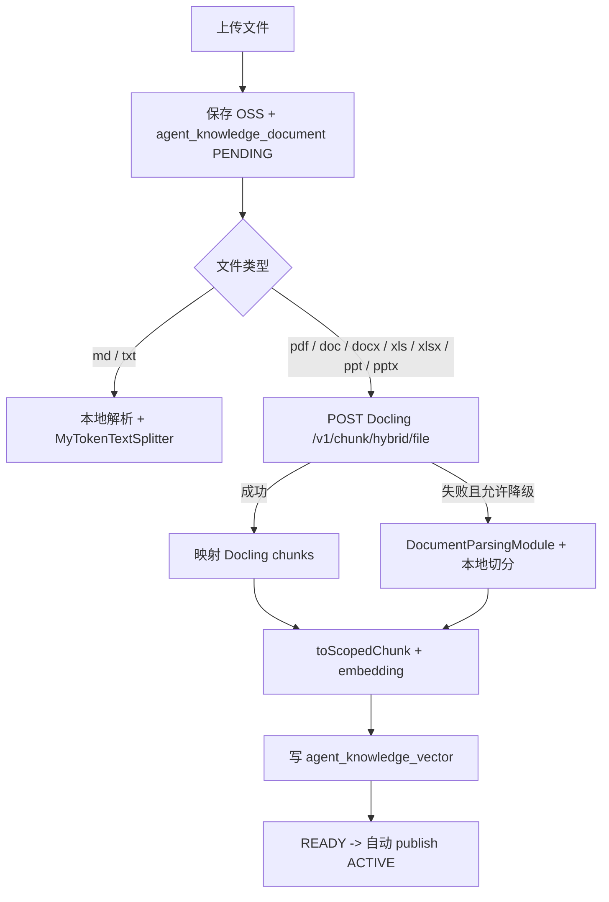

# Docling Serve 接入知识库入库链路

> 状态：已实施（2026-10-20）。实现：`DoclingServeClient`、`DoclingServeChunkingService`、`AgentKnowledgeDocumentService`。
> 目标：PDF/Word/Excel/PPT 的解析与切片调用独立 Docling Serve；Markdown/TXT 继续走本地结构化切分。

## 1. 边界

Docling Serve 负责：

- 文档解析：PDF 版面、阅读顺序、表格、页码；Office 标题/段落/表格。
- 切片：`/v1/chunk/hybrid/file` 返回结构感知 chunks。

当前 Spring Boot 服务负责：

- 上传、版本治理、对象存储、租户/Agent 隔离。
- 调用 Docling Serve、映射 metadata、写入 PGVector。
- 失败重试、状态展示，以及本地解析/切分降级。

## 2. 入库流程



## 3. 配置

```yaml
app:
  document-parser:
    docling:
      enabled: true
      base-url: http://127.0.0.1:5001
      timeout-seconds: 180
      fallback-to-local: true
      formats: pdf,doc,docx,xls,xlsx,ppt,pptx
      table-mode: accurate
      do-ocr: true
      do-table-structure: true
```

- `enabled=false` 时行为与当前完全一致。
- `fallback-to-local=true` 时 Docling 超时/5xx/返回空 chunks 会回退到现有解析与切分。
- 后端容器化后 `base-url` 改为 `http://docling-serve:5001`。

## 4. Docling 请求

```http
POST /v1/chunk/hybrid/file
Content-Type: multipart/form-data

files=@document.pdf
convert_from_formats=pdf
convert_do_ocr=true
convert_do_table_structure=true
convert_table_mode=accurate
```

响应 `chunks[]` 关键字段：

| 字段 | 映射 |
| --- | --- |
| `text` | chunk 正文 |
| `chunk_index` | 0-based，最终写为 `chunkIndex = index + 1` |
| `headings` | `sectionPath` |
| `page_numbers` | `pageNumber`（取第一个） |
| `num_tokens` | `tokenCount` |
| `doc_items` | `docItems` |
| `metadata.origin.mimetype` | `sourceMimeType` |

chunk 额外 metadata：

- `parser=docling-serve`
- `chunking=docling-hybrid`
- `doclingChunkIndex`
- `headings`
- `pageNumbers`

最终仍由 `toScopedChunk` 写入 `documentId`、`tenantId`、`agentKey`、`logicalKey`、`versionNo`、`lifecycleStatus`、`chunkIndex`。

## 5. 实现落点

| 类 | 作用 |
| --- | --- |
| `DoclingServeClient` | multipart 调用 `/v1/chunk/hybrid/file`，连接超时 3s、读取超时 180s |
| `DoclingServeChunkingService` | 校验 chunks、映射标题/页码/token/metadata，空 chunks 视为失败 |
| `AgentKnowledgeDocumentService.indexDocument` | 按扩展名分流；Docling 失败且允许降级时回退本地解析+切分 |
| `AgentKnowledgeDocumentService.getDocument` | 本地解析失败时用已入库 chunks 拼接详情原文，避免 Office/扫描件详情页 500 |

默认配置：

```yaml
app:
  document-parser:
    docling:
      enabled: true
      base-url: http://127.0.0.1:5001
      timeout-seconds: 180
      fallback-to-local: true
      formats: pdf,doc,docx,xls,xlsx,ppt,pptx
      do-ocr: true
      do-table-structure: true
      table-mode: accurate
```

## 6. 失败与重试

- Docling 4xx：文件格式/参数问题，标记 `FAILED`，提示具体原因，不无限重试。
- Docling 5xx/超时/连接失败：可降级到本地；若关闭降级，标记 `FAILED`，由现有索引重试任务按次数重试。
- 返回空 chunks：视为失败；可降级。
- 降级日志只记录文件名、类型、状态码、耗时，不记录文档内容。

## 7. 兼容性

- 不改变 `agent_knowledge_document` 表结构和版本发布逻辑。
- 不改变现有 `agent_knowledge_vector` metadata 合同和引用格式。
- `.md/.txt` 继续走 `MyTokenTextSplitter.splitStructuredMarkdown`，避免不必要变化。
- `getDocument` 详情页暂时仍使用本地解析器展示原文；Docling chunks 以数据库切片为准。

## 8. 验证

- 单元测试：`DoclingServeChunkingServiceTest` 覆盖 metadata 映射与空 chunks；`AgentKnowledgeDocumentServiceUploadTest` 保持通过。
- 真实 PDF 上传：`静安约会计划.pdf` → `READY`，9 chunks，保留 Markdown 标题/段落/表格。
- 真实 DOCX 上传：`docling-test.docx` → `READY`，1 chunk。
- 管理端文档详情在本地解析失败时会回退展示已入库 chunks。
- Markdown/TXT 仍走本地 `MyTokenTextSplitter`。

## 9. 已知边界

- 当前使用同步 chunk 接口；大文件可能触发 Docling 120s 同步等待上限，后续可切换 async + 轮询。
- 首次 PDF/Word 请求会下载 Docling 模型，耗时明显；模型缓存卷需持久化。
- 文档详情页展示的是本地解析文本，不是 Docling 的 Markdown；后续可持久化 `parsed_content`。
- 运行环境为 OrbStack ARM64；x86 部署需调整运行时构建。
- 需要持续评估中文 OCR 和复杂表格质量。
