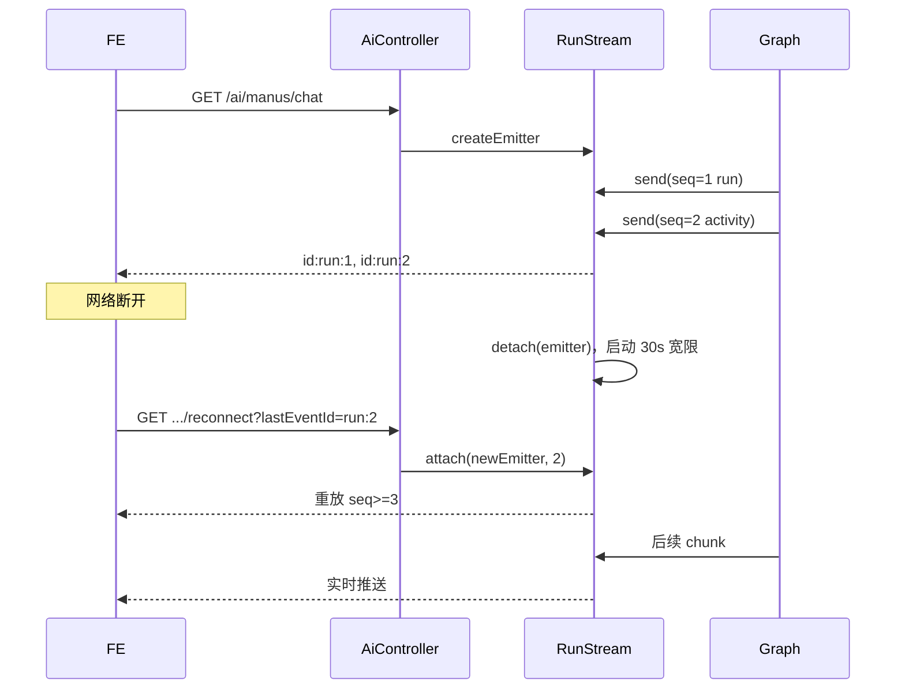

# 超级智能体 SSE 断线重连与事件回放

> 状态：已实施（2026-10-20）。源码：`RunStream`、`ManusGraphOrchestrator.reconnect`、`AiController.reconnectManusRun`。

## 1. 目标

浏览器网络抖动、切后台或 EventSource 重连时，不丢已生成的回答片段和 activity。断线重连是连接层能力，进程崩溃后的任务续跑由 `agent_run` 检查点负责。

## 2. 设计

### 2.1 RunStream

每个 run 对应一个 `RunStream`：

- 为所有 SSE 事件分配 run 内单调递增序号，事件 ID 为 `<runId>:<sequence>`。
- 保存有界事件历史（默认 5000 条），包括 `run`、`rag-trace`、`activity`、回答 chunk、`interrupted`、`[DONE]`。
- 维护当前 `SseEmitter`；执行线程只写 `RunStream`，不直接持有连接。
- 客户端断开时仅解绑 emitter，并在宽限期（默认 30s）后仍无重连才停止执行。
- 重连时取消停止定时器，重放 `Last-Event-ID` 之后的事件，并继续实时推送。
- run 完成后保留事件历史一段时间（默认 120s），允许补看最终事件。

### 2.2 事件顺序



## 3. 接口与前端

```text
GET /api/ai/manus/conversations/{conversationId}/runs/{runId}/reconnect?lastEventId={runId}:{seq}
```

- 前端 SSE 解析器记录每个事件的 `id`，断开后最多重试 3 次，带 `lastEventId` 重连。
- 重连成功只补发缺失事件，不重复现有内容。
- 重连返回 409（历史缺口或 run 不在本实例）时，前端回退到重新加载历史；若 run 已中断，用户可点击“继续生成”。

## 4. 配置

| 配置 | 默认 | 说明 |
| --- | ---: | --- |
| `app.agent.sse-reconnect-grace-seconds` | 30 | 客户端断开后继续执行并等待重连的时间 |
| `app.agent.sse-history-max-events` | 5000 | 单 run 内存事件历史上限 |
| `app.agent.sse-replay-retention-seconds` | 120 | run 完成后保留可回放事件的时间 |

## 5. 已知边界

- 事件历史保存在 JVM 内存；进程重启后不能实时重连，需使用 `resume` 从检查点续跑。
- 多实例部署时，重连请求必须命中执行该 run 的实例；否则返回 409。生产化需要共享事件总线或粘性路由。
- 关闭页面/主动取消后，服务端仍会保留最长 30s 宽限期继续执行；如需“立即停止”，应增加显式取消接口。
