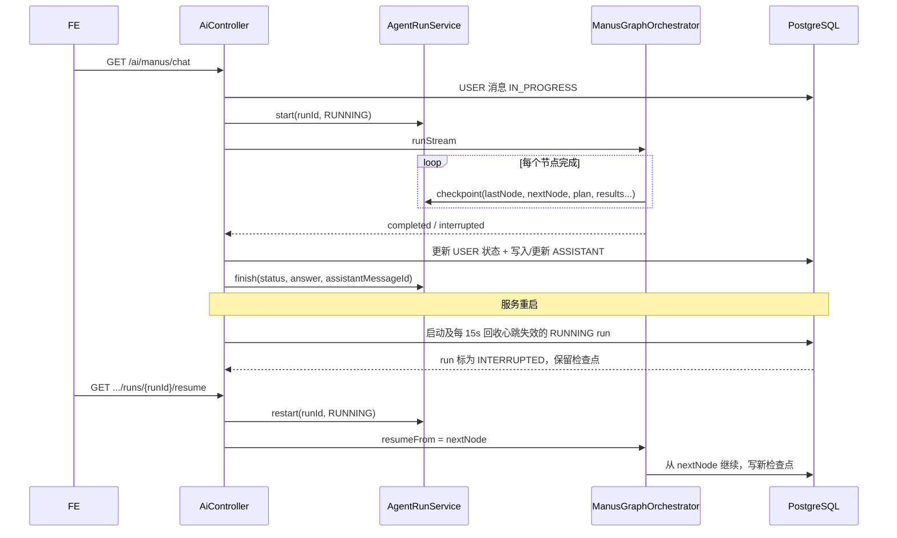

# 超级智能体跨重启续跑

> 状态：已实施（2026-10-20）。对应迁移 V11、V12；源码以 `ManusGraphOrchestrator`、`AgentRunService`、`AgentRunRecoveryJob` 为准。

## 1. 目标

同一 `conversationId` 下，用户不应感知服务重启。具体拆成两层：

1. **对话连续性**：重启后继续发消息，历史轮次、部分回答和未完成状态仍然存在。
2. **执行连续性**：未完成的图执行从最近检查点继续，而不是从 planner 重做。

## 2. 数据模型

`agent_run` 保存一次图执行实例：

| 字段 | 作用 |
| --- | --- |
| `id` | run 标识，同时作为前端续跑入口 |
| `conversation_id` / `user_message_id` | 归属与用户轮次 |
| `assistant_message_id` | 同一轮助手消息，恢复时原地更新 |
| `status` | `RUNNING` / `COMPLETED` / `INTERRUPTED` / `FAILED` |
| `last_node` / `next_node` | 最近完成节点与恢复入口 |
| `plan` / `task_results` / `activities` / `sse_events` | 可恢复的图状态 |
| `verification_status` / `verification_feedback` / `revision` | 质检状态 |
| `final_answer` / `partial_answer` | 最终/部分回答 |
| `owner_instance` | 执行该 run 的服务实例 |

`agent_instance` 保存实例心跳；`agent_conversation_lock.owner_instance` 记录租约归属。崩溃实例心跳停止后，其 run 和租约可被其他实例接管。

## 3. 执行与恢复流程



## 4. 恢复路由

| 最近完成节点 | 恢复入口 |
| --- | --- |
| 无检查点 | `planner` |
| `planner` | `workers` |
| `workers` | `verifier` |
| `verifier` + `revise` | `workers`（清空上一轮 worker 结果） |
| `verifier` + `pass/unverified` | `aggregator` |
| `aggregator` | `aggregator`（重新生成最终答案） |

## 5. 实现要点

- 每个 run 编译独立图实例，避免图库共享 `OverAllState` 导致跨 run 状态串轮。
- 图库 `NodeOutput` 使用共享状态引用，输出标签与“刚完成节点”可能错位；检查点通过状态内容推断完成节点。
- `partial_answer` 在流式生成期间按约 750ms 落库，进程崩溃也能保留已生成草稿。
- 新轮次开始前，同会话遗留 `IN_PROGRESS` 用户轮次会被标为 `INTERRUPTED`。
- 恢复时只重建租户/工具/RAG 上下文，不持久化 `SseEmitter`、`ToolCallback` 等运行时对象。

## 6. 接口

```text
GET /api/ai/manus/conversations/{conversationId}/runs/{runId}
GET /api/ai/manus/conversations/{conversationId}/runs/{runId}/resume
```

## 7. 已知边界

- 恢复粒度到节点；workers 内部已完成的子任务会整节点重跑。
- 工具副作用幂等由 V13 账本负责，详见 `2026-10-20-tool-call-idempotency.md`。
- 跨实例恢复依赖数据库检查点与实例心跳；SSE 实时重连仍要求请求命中执行实例，详见 `2026-10-20-sse-reconnect-replay.md`。
