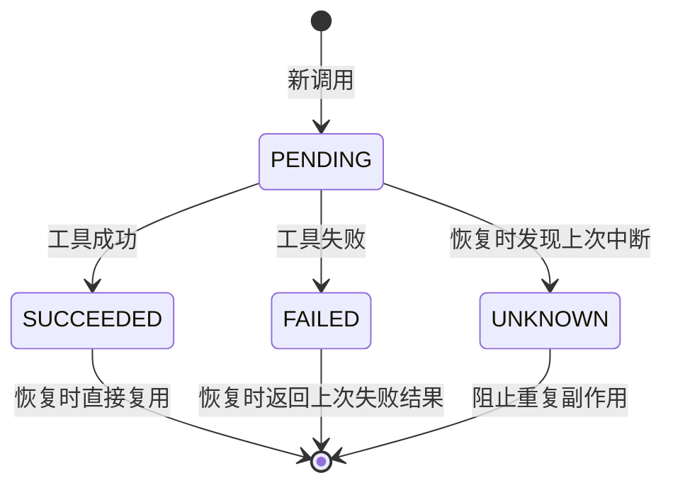
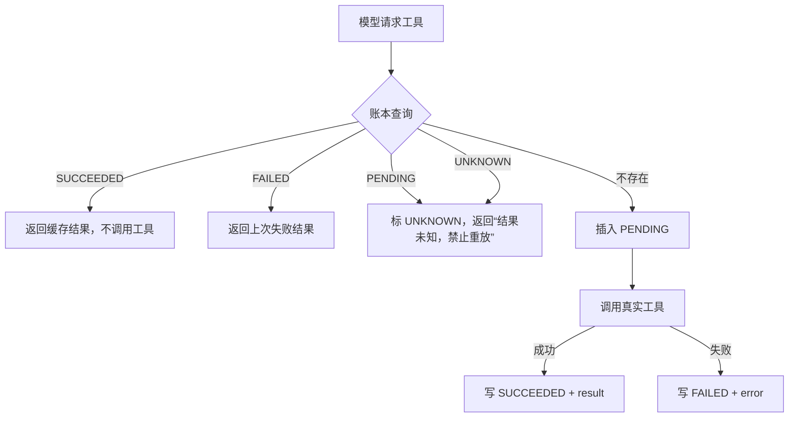

# 超级智能体工具调用幂等

> 状态：已实施（2026-10-20）。对应迁移 V13；源码：`AgentToolCallLedgerService`、`IdempotentToolCallback`。

## 1. 为什么需要

节点级恢复会重跑整个 workers 节点。若上一轮已经搜索网页、下载文件、写 PDF、查外部库或调用 MCP，恢复后可能重复执行，造成费用、重复文件或数据副作用。

## 2. 账本模型

`agent_tool_call`：

| 字段 | 说明 |
| --- | --- |
| `run_id` | 所属 run |
| `tool_name` | 工具名 |
| `arguments_hash` | 参数的 SHA-256 |
| `arguments` | 原始参数（便于审计，注意敏感信息） |
| `status` | `PENDING` / `SUCCEEDED` / `FAILED` / `UNKNOWN` |
| `result` | 成功或失败结果（上限 200k 字符） |

唯一键：`(run_id, tool_name, arguments_hash)`。

## 3. 状态机

## 4. 运行时行为

- 包装层 `IdempotentToolCallback` 对超级智能体本次 run 的全部工具生效。
- 恢复时复用成功结果，避免重复搜索、下载、写文件、生成 PDF、外部 SQL 和 MCP 调用。
- 上次调用可能已发生但结果未知时，不自动重试，而是返回明确提示，让模型向用户说明。

## 5. 已知边界

- 相同 `toolName + arguments` 在同一 run 内会被视为同一次调用；如果业务确实需要重复执行同一参数，需要显式区分参数或后续增加调用意图键。
- `FAILED` 会缓存失败结果，不自动重试；瞬时故障需要用户重新发起。
- 账本保存工具参数和结果，需纳入数据保留、脱敏和删除策略。
- 当前只覆盖超级智能体；travel/test/love 的单体链路尚未接入。
