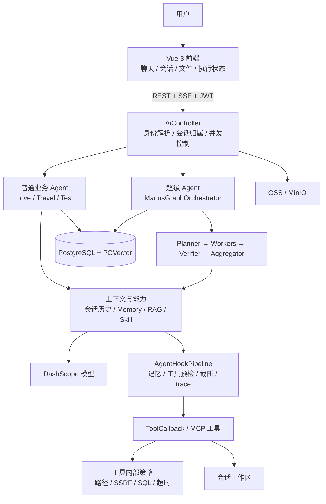

# Agent 项目面试问题与回答

> 本文保留原始问题、后续追问和回答口径，便于后续继续补充。回答以仓库当前源码为准；“已实现”和“建议补充”分开描述，避免把规划说成现状。

## 对话记录与回答约束

### 原始问题

2. 讲一下你做过的 AI Agent 项目，整体架构和调用链路。
3. Agent 里 Planning、Memory、Tool Calling、Reflection 分别怎么落地。
4. Agent 调用外部工具时，怎么做权限控制和审计。
5. 如果 Agent 能执行 shell 命令，怎么防止它被执行恶意命令。
6. Prompt Injection 在 Agent 场景下比普通大模型更严重，为什么。
7. 用户给 Agent 发一段网页内容，Agent 自动抓取并总结，怎么防 SSRF。
8. Agent 读取邮件、文档、数据库后做自动回复，怎么防数据泄露。
9. Golang 里 goroutine 泄漏怎么排查，举一个 Agent 服务里的真实场景。
10. Golang channel 在 Agent 多任务编排里怎么用，关闭 channel 有哪些坑。
11. Golang 上下文取消 context.Context 在 Agent 超时、中断、人工介入时怎么设。

### 用户后续要求

- 将第 9–11 题中的 Golang 相关问题改成 Java。
- 回答要结合当前项目背景，解释设计背后的风险，不要停留在概念罗列。
- 首先讲清楚项目整体架构和调用链路。
- 后续回答需保留原始问题与追问，持续更新本文件。

## 先讲整体架构

这个项目不是单纯的“聊天接口 + 大模型”，而是一个带有认证、会话、记忆、知识检索、工具执行和多智能体编排的应用。整体分为前端交互、API 与身份、Agent 编排、Agent 能力、工具安全、数据与基础设施六个部分。



### 普通 Agent 与超级 Agent 的区别

“普通”和“超级”在这里指执行编排方式，不代表模型等级或权限等级。

| 对比项 | 普通业务 Agent | 超级 Agent（Manus） |
| --- | --- | --- |
| 代码入口 | `LoveApp`、`TravelPlannerApp`、`TestAgentApp` 等业务应用 | `ManusGraphOrchestrator` |
| 控制方式 | 面向单一场景的固定业务流程；内部可直接调用模型、RAG、视觉服务或工具 | 显式图状态机：Planner、Workers、Verifier、Aggregator |
| 任务分解 | 通常由当前业务流程和单轮模型请求完成，不默认创建多个子任务 | Planner 输出最多 4 个子任务并分配角色 |
| 并行 | 一般没有任务级多 Agent 并行；RAG 等内部 I/O 可以异步 | 多个 Worker 通过专用 executor 并行执行 |
| 工具范围 | 按业务和技能配置提供工具 | Worker 按 researcher/author/analyst/general 角色过滤工具；通用角色当前可见全部已注册工具 |
| 质量检查 | 主要由业务提示词、结构化处理和后端校验负责 | Verifier 检查结果，必要时返工一轮，再由 Aggregator 汇总 |
| 适用问题 | 目标清楚、流程稳定、领域边界明确，例如情感对话、旅游规划 | 跨领域、多步骤、可拆分并行，且需要统一验收和交付的任务 |
| 额外成本 | 调用链较短，延迟和模型成本更可控 | 多次模型调用、子任务并发和结果合并带来更高延迟、成本与故障面 |

因此，超级 Agent 不是普通 Agent 的简单升级版。能用固定业务流程解决的问题，优先使用普通 Agent；只有确实需要拆解、并行和跨角色协作时才使用超级 Agent。否则会增加规划错误、工具权限扩散、并发取消和结果冲突等风险。

### 普通 Agent 的调用链

不同普通 Agent 的业务链并不完全相同，不能概括为所有请求都走同一个 ReAct 循环：

```text
HTTP/SSE 请求
 → JWT 身份与会话归属校验
 → Love / Travel / Test 对应业务应用
 → 加载会话上下文、长期记忆、必要时做 RAG 或图片理解
 → 调用模型
 → 若有工具调用则经 ToolCallback 执行（适用的 Agent Hook 会在工具前预检）
 → 返回流式答复并保存会话、引用或执行事件
```

情感 Agent 包含文本/图片分流、视觉模型、RAG 与引用；旅游 Agent 使用租户知识库和可选联网搜索；测试 Agent 复用通用租户知识库对话链路。它们共享认证、存储、RAG、工具和线程池基础设施，但业务编排不同。

### 超级 Agent 的调用链

```text
POST/SSE /ai/manus/chat
 → Controller 解析身份、检查会话和请求
 → 构造本次 RunContext 与会话工作区工具
 → Planner 产出结构化子任务（最多 4 个）
 → Workers 按角色过滤工具，并行运行子 Agent
 → Verifier 检查完整性；最多要求返工一轮
 → Aggregator 汇总子任务结果
 → SSE 推送 activity、最终答案和 DONE
 → 记录执行结果与会话消息
```

当前图状态使用 `conversationId` 作为 thread ID，并配置 `MemorySaver`。它用于当前实现中的 checkpoint 状态隔离和后续恢复基础，不应表述成跨进程持久化恢复。当前超级 Agent 是每个请求新建一次图执行上下文；是否跨请求复用状态要以实际持久层实现为准。

### 横向 Hook 与安全边界

Agent Hook Pipeline 提供统一生命周期切点，包括运行前、步骤前、工具调用前后、运行结束、错误和中断。当前实现包含记忆注入/压缩/提取、执行 trace、工具结果截断和 ToolGuard。

工具路径是：

```text
模型产生 Tool Call
 → 当前 Agent/Worker 的工具暴露范围
 → ToolGuard 对已知工具做集中参数预检
 → 工具自身做第二次校验
 → 执行与结果记录/截断
 → 工具结果返回模型
```

Hook 不是最终安全边界。工具内部校验、数据库权限、工作区文件系统隔离和网络出口控制都必须独立成立。未知工具当前不会被 ToolGuard 自动拒绝，需要工具注册和工具层策略覆盖。

### 架构里容易被忽略的风险

- **身份传递**：异步 Worker 必须带着正确的 tenant/user/run 身份，否则数据隔离和审计会断链。
- **Prompt Injection**：网页、文档、邮件与工具结果是数据，不是可信指令；它们可能经 Planner 和子 Agent 传播。
- **并行副作用**：并行 Worker 写同一文件或操作相同外部资源可能冲突，任务依赖不能错误地并行化。
- **取消传播**：停止标记和线程中断不保证 HTTP 请求、数据库驱动或子进程立即停止。
- **状态持久化**：内存 checkpoint 不能承担实例重启后的恢复承诺。
- **审计与隐私**：工具参数和结果可能包含密码、个人信息或商业数据，审计必须做分级脱敏和访问控制。
- **权限不是 Prompt**：模型提示词里的“不要做某事”不能替代服务端授权和工具沙箱。

## 2. 讲一下你做过的 AI Agent 项目，整体架构和调用链路

我做的是一个基于 Java 21、Spring Boot、Spring AI 和 Spring AI Alibaba Graph 的 AI Agent 应用。它包含面向情感咨询、旅游规划和功能测试的普通业务 Agent，也包含一个通过图状态机进行多智能体协作的超级 Agent。底层接入 DashScope，使用 PostgreSQL/PGVector 保存会话、知识文档和向量，使用 OSS/MinIO 保存图片与知识文件，前端用 Vue 3 通过 REST 和 SSE 交互。

请求先由 Controller 完成认证身份、会话归属和并发检查，再进入对应业务应用。普通 Agent 根据领域流程加载历史、记忆、RAG 或视觉上下文后调用模型；超级 Agent 则先规划任务，再并行执行角色化 Worker，经过 Verifier 后由 Aggregator 交付。模型的工具调用经过工具暴露范围、ToolGuard 预检和工具自身校验，执行过程通过 SSE 和持久化事件体现。

这样设计是因为模型只是概率性的决策器，不能让它直接决定资源权限。身份、租户、工具权限、路径、URL、SQL、超时和审计必须由后端代码与基础设施兜底。

## 3. Agent 里 Planning、Memory、Tool Calling、Reflection 分别怎么落地

### Planning

超级 Agent 的 `PlannerNode` 要求模型生成 JSON 子任务，解析器把任务约束在最多 4 项，并指派 researcher、author、analyst 或 general 角色。解析或模型调用失败时回退为单个 general 任务，减少规划服务故障导致整条任务无法运行的概率。

规划结果是执行建议，不是权限令牌。Worker 启动时仍由代码过滤工具。否则 Planner 一旦被 Prompt Injection 影响，就能通过计划把越权任务伪装成正常子任务。

### Memory

有三种不同用途的状态：工作记忆是当前 run 的模型消息与工具消息；会话记忆用于跨请求恢复近期对话；长期记忆从明确表达的偏好或约束中异步提取事实，并在之后相关请求中注入。另有上下文超预算时的压缩逻辑。

长期事实当前按租户、Agent、用户范围查询并带来源会话信息，提取开关默认关闭。隐患是模型可能抽错事实、事实过期、用户无法纠正，或把记忆内容误当成可信指令。成熟实现应支持用户查看/删除、时效、来源、置信度和敏感信息策略。

### Tool Calling

Spring AI 把模型工具调用映射到 Java ToolCallback。超级 Agent 的 Worker 根据角色过滤工具；ToolGuard 对终端、文件路径和网页 URL 等已知调用做集中预检；工具内部再执行路径沙箱、URL、SQL、大小和超时校验。

模型输出的函数名和参数一律视为不可信输入。Tool Calling 的安全重点不是“Prompt 写得严格”，而是每次执行都按当前身份重新授权，并限制工具能访问的资源。

### Reflection

Verifier 对照原始请求、计划和 Worker 结果，输出 pass 或 revise。revise 会携带反馈再执行 Workers，最多一轮；之后 Aggregator 统一生成最终答案。

这能补充遗漏，但不等于事实核验。Verifier 可能和 Worker 共享相同模型偏差，或对错误结果过度自信。因此关键场景应结合来源证据、规则校验、数据库约束和人工抽检。

## 4. Agent 调用外部工具时，怎么做权限控制和审计

先由服务端身份确定 userId、tenantId、role 和 conversationId，再根据 Agent 与 Worker 角色决定可见工具；工具入口继续检查参数和资源范围。外部系统凭据由服务端保管，不能让模型直接提供任意凭据并无限制连接。

审计至少关联 runId、用户/租户、Agent、会话、工具名、策略决定、脱敏参数摘要、耗时、结果摘要和错误。密码、Token、个人信息和完整文档内容不能原样进入普通日志。高风险副作用如发邮件、删除、写外部系统，应采用审批或草稿模式。

当前项目已有角色工具过滤、ToolGuard 日志、执行 trace 和工具内部策略；仍需谨慎描述审计完整度。未知工具不由 ToolGuard 自动拒绝，数据库查询也主要依赖各自工具的 SQL 策略，尚不是所有工具共用同一套细粒度授权与不可篡改审计系统。

## 5. 如果 Agent 能执行 shell 命令，怎么防止它被执行恶意命令

把 Shell 视为远程代码执行能力，而不是普通查询工具。当前应用层做法包括：终端默认关闭、命令 allowlist、拒绝 shell 元字符、拒绝绝对路径和路径穿越、限制 Python 解释器选项、限制运行时间和输出大小，并由 ToolGuard 与终端工具本身重复校验。

这些检查能挡住常见命令拼接和越界路径，但不能证明命令安全。allowlist 命令本身也可能通过参数访问敏感文件；符号链接、环境变量和系统差异也会带来绕过可能。生产运行应在非 root 容器或专用执行服务里运行，只挂载任务工作区，限制网络、进程、CPU、内存和磁盘，并禁止访问宿主 Docker Socket。对无法可靠约束的解释器应移除。

## 6. Prompt Injection 在 Agent 场景下比普通大模型更严重，为什么

普通聊天场景里的注入主要影响回答；Agent 场景里的模型有工具权限，注入可能诱导真实读取、联网、查询、写入或发送动作。攻击内容还会通过工具结果、长期记忆、Planner 和 Worker 在多个步骤之间传播。

因此要把网页、文件、邮件和数据库内容标为不可信数据，避免把它们拼成高优先级系统指令；工具权限必须在服务端执行时校验；敏感读取和外发动作要审批；工具结果和最终答案要做脱敏与审计。单靠 Prompt 说“忽略恶意指令”无法构成安全边界。

## 7. 用户给 Agent 一段网页内容，Agent 自动抓取并总结，怎么防 SSRF

SSRF 的风险是服务端替用户访问内网、localhost 或云 metadata。应限制协议为 HTTP/HTTPS，拒绝 URL 凭证，解析 DNS 后检查所有 IPv4/IPv6 地址，并在每次重定向后重新校验；还要限制跳转次数、响应大小和超时。

DNS 检查和实际连接之间可能发生 DNS rebinding，所以生产系统还应使用受控 egress proxy 或把校验过的目标 IP 固定到实际连接，同时保留正确的 Host/TLS 校验。网络层要阻止访问私网与 metadata。

当前项目 `UrlAccessPolicy` 已检查 HTTP(S)、凭证 URL 和多类非公网地址，并被抓取与下载工具复用。应用层校验不等于完整的 DNS rebinding 防护，面试中应说明这一边界。

## 8. Agent 读取邮件、文档、数据库后做自动回复，怎么防数据泄露

需要同时管住读取和外发：读取侧按用户、租户、资源 ACL 做最小授权；数据库限制只读、表范围、行数和超时；检索严格带租户过滤；模型上下文只放完成任务所需字段并脱敏。外发侧校验收件人、域名、附件、敏感数据和批量发送，并默认生成草稿，让用户确认后发送。

还要防止被读取内容里的指令诱导 Agent 泄露别的数据。邮件正文和文档是数据，不是授权来源。审计记录读取来源、工具调用、敏感字段处理、审批人和收件人，但对正文与凭据做脱敏。

当前项目具备 JWT 身份、知识库租户隔离、私有对象存储及只读 SQL 工具基础；邮件发送、通用 DLP 和审批恢复链路不应描述成已实现能力。

## 9. Java 里线程泄漏怎么排查，举一个 Agent 服务里的真实场景

Agent 服务里常见情况是客户端断开后模型 HTTP 调用或 Worker 仍阻塞，线程长期占用。请求增多后，Worker executor 队列积压，继而造成模型连接池或数据库连接池耗尽。

排查时观察线程数、executor 活跃数与队列长度，采集 `jstack` 或 JFR，按线程名和栈定位阻塞点；区分模型网络等待、JDBC、锁竞争、`Future.join()` 和未关闭流。然后沿 SSE 断开、停止标记、Worker 中断、底层客户端取消的链路逐层验证。

当前超级 Agent 在 SSE 超时/错误时设置停止标记并调用 `WorkersNode.stopAll()`；Worker finally 会从活动集合移除。RAG 和部分工具有超时。不过 `Future.cancel(true)` 只是中断请求，底层网络 I/O 不一定立即停止，需要连接/读取超时和可取消客户端配合。应通过断连压力测试确认线程与队列能回落。

## 10. Java 里线程池和 CompletableFuture 在 Agent 多任务编排里怎么用，有哪些坑

当前 Workers 对每个子任务使用 `CompletableFuture.supplyAsync(..., workerExecutor)`，指定图 Worker 专用 executor 并行执行，随后逐个收集结果与异常。不要使用默认 common pool 承载长时间模型或网络 I/O。

需要关注有界线程数和队列、拒绝策略、总 deadline、异常聚合、结果顺序、共享可变状态和取消传播。取消父 `CompletableFuture` 不保证子任务或底层 HTTP/JDBC 也取消。每个 Worker 应返回独立结果，由协调器聚合；run context 应持有子任务句柄和取消状态，结束时统一取消未完成任务。

并行也只适用于真正独立的任务。如果多个 Worker 同时写相同文件、修改相同资源或依赖前序结果，必须显式建依赖或加隔离，不能因为并发“更快”就强行并行。

## 11. Java 里超时、中断、人工介入时怎么控制 Agent

Java 没有标准的 `context.Context` 等价物，通常要实现 run 级上下文，携带 runId、身份、deadline、取消 token、子 Future、订阅句柄和审批状态。

- **超时**：每层根据总 deadline 计算剩余预算，传播给模型 HTTP、RAG、JDBC、网页抓取和工具；达到期限后不再启动新子任务，并取消正在运行的调用。
- **用户中断**：SSE 断开时设置取消状态、停止新增任务、取消子 Worker 和订阅，关闭流与临时资源，并记录 interrupted 结果。
- **人工审批**：高风险 Tool Call 进入 `WAITING_APPROVAL`，保存调用计划和 run 状态，用户批准后服务端重新授权再执行；拒绝或超时则把拒绝结果反馈给模型。不能仅靠前端按钮决定执行权限。

当前项目已有 SSE 停止标记、Worker 停止逻辑、RAG/工具超时和中断记录，但并没有贯穿所有底层调用的统一取消上下文，也没有完整的人审后恢复状态机。准确说法应是“具备部分停止和超时机制，统一生命周期治理仍需补齐”。

## 当前项目的安全边界速记

面试时可以用这段收尾：

> 这个项目已经把 Agent 的主要执行链路跑通了，包括业务 Agent、多智能体图编排、RAG、长期记忆和 Tool Calling；安全上做了 JWT 身份、租户隔离、工具角色过滤、路径工作区、URL/SQL 策略和 ToolGuard 预检。但我会把应用层护栏和完整沙箱区分开，也会把内存 checkpoint 和持久化恢复区分开。生产化还要继续补齐容器级执行隔离、统一授权审计、DNS rebinding 防护、人工审批、全链路取消和端到端安全评测。

## 12. 当前项目还有哪些地方做得不够，需要怎么完善

以下状态已按 2026-10-19 工作区源码复核；本轮改动尚未提交。项目已有业务 Agent、显式多 Agent 图、RAG、长期记忆、MCP、租户身份和工具护栏，但“有应用层校验”不等于“具备 OS 隔离或生产级治理”。

### 已补齐或本轮加固

1. **Verifier fail-open 已修正。** 模型调用/解析失败记为 `unverified`，达到返工上限仍未通过时由 Aggregator 标注 `[未验收]`；仍不是事实证明器，重要结果需要证据来源或人工验收。
2. **ToolGuard 未知工具默认拒绝。** `APP_ALLOWED_UNREGISTERED_TOOLS` 可显式放行名称；这是兼容开关，不包含 schema 级参数授权、资源范围或风险分级，MCP 工具仍需逐项登记策略。
3. **敏感正文日志已收敛。** ToolGuard、执行 trace、模型 Advisor、LoveApp 和 ToolCallAgent 不应记录原始参数/prompt/回答；本轮已将 Advisor/Agent 相关日志改为事件和长度。仍需持续审查异常栈、第三方 SDK 与访问受控的审计保留策略。
4. **会话锁已改为 PostgreSQL lease。** 锁键纳入 tenant/user/agent/conversation，token 条件释放并定时续期；Manus 准备或提交失败会及时释放。DB 长时间不可用时续租可能失败，租约到期后仍有并发窗口；需监控续租失败并做多实例故障演练。
5. **Worker 取消与 executor 拒绝已加固。** Worker 使用 `FutureTask` 并按 conversation 取消；有界池改为显式拒绝，RAG 队列满时降级、Worker 队列满时报告未启动。线程中断不保证底层模型 HTTP/MCP/JDBC 已停止，参数仍需负载测试确定。
6. **SSRF 已有应用层防护。** 抓取拒绝未逐跳检查的自动重定向，下载逐跳校验；外部数据库目标在连接前校验公网 IP。DNS rebinding/解析与连接竞态未由 egress proxy/fixed IP 消除；企业内网 DB 目标目前也会被拒绝。

### 仍需处理的主要缺口

7. **终端工具不是操作系统沙箱。** 字符串 allowlist 不能证明命令无副作用；当前应用容器仍含服务凭据、网络和挂载能力。真正隔离需要独立执行容器/服务、最小挂载、无网络或受控出网、非 root、只读根文件系统、CPU/内存/进程配额及逃逸测试。不能仅靠给整个后端容器加限制就宣称完成。
8. **工具授权仍偏工具名/角色级。** 在执行时还应基于 tenant/user/agent、目标资源和动作重新授权；高风险写操作需审批状态、幂等键和不可篡改审计。allowlist 的工具还没有专属参数策略。
9. **长期记忆缺少用户治理闭环。** 已有异步提取、注入和压缩；查看/编辑/删除、过期、敏感事实过滤、来源追踪，以及账号/租户删除联动仍未形成完整产品路径。
10. **数据生命周期尚未统一。** 会话、记忆、文档、图片、执行 trace、日志和备份需要明确保留/删除/导出/脱敏及审计策略；删除业务记录不自动证明所有副本都已清除。
11. **运行恢复仍有限。** 图使用内存 saver，不支持进程重启后的可靠恢复；取消/超时尚未贯穿所有底层调用，也没有人工审批后恢复状态机。
12. **质量与运维缺少门禁。** 需要建立 RAG/工具选择/任务成功率/安全攻击的离线数据集，并形成延迟、费用、队列饱和、RAG 降级、取消和 MCP 健康指标与告警。当前单测通过不代表线上质量。
13. **外部数据库仍需专用出网治理。** 除公网目标检查外，还需域名/IP allowlist、DNS rebinding 防护、凭据托管/短期凭据、出网策略和连接审计；公网可达并不等于业务授权。

建议按安全边界（独立终端执行服务、资源级授权、外部 DB egress）→ 数据治理（记忆与全生命周期）→ 可恢复运行/人工审批 → 离线质量门禁与线上 SLO 的顺序推进。路线图状态以 `doc/ROADMAP.md` 为准并持续随源码更新。

### 建议的落地顺序

1. 把 Verifier 异常从 pass 改为显式未验收状态，并为失败策略补测试。
2. 对 ToolGuard/MCP 做 fail-closed 策略登记，同时先移除原始工具参数日志。
3. 给超级 Agent 建立 run 级 deadline/cancellation 注册表，修复断连、竞态与多实例并发问题。
4. 把终端能力迁入操作系统级沙箱，并对外部数据库连接加出网限制。
5. 建立安全与任务质量评测集、运行指标和更新后的路线图。

这个排序优先处理“失败时会不会错误放行”和“数据/命令能不能越权”，再处理可恢复性和质量优化。若项目定位只是本地演示或作品集，可把容器隔离、多实例锁和完整数据治理列为生产化工作；但 Verifier fail-open 和敏感参数日志仍值得尽早处理。

## 源码索引

- 架构说明：`design/agent-architecture.md`
- 图式多 Agent：`src/main/java/com/zwx/zwxagent/agent/graph/ManusGraphOrchestrator.java`
- 规划、执行、验收与交付：`PlannerNode.java`、`WorkersNode.java`、`VerifierNode.java`、`AggregatorNode.java`
- 普通业务链：`src/main/java/com/zwx/zwxagent/app/`
- Hook 管线：`src/main/java/com/zwx/zwxagent/agent/hook/`
- 工具策略：`src/main/java/com/zwx/zwxagent/tools/`
- Controller 与身份：`AiController.java`、`CurrentActor.java`
