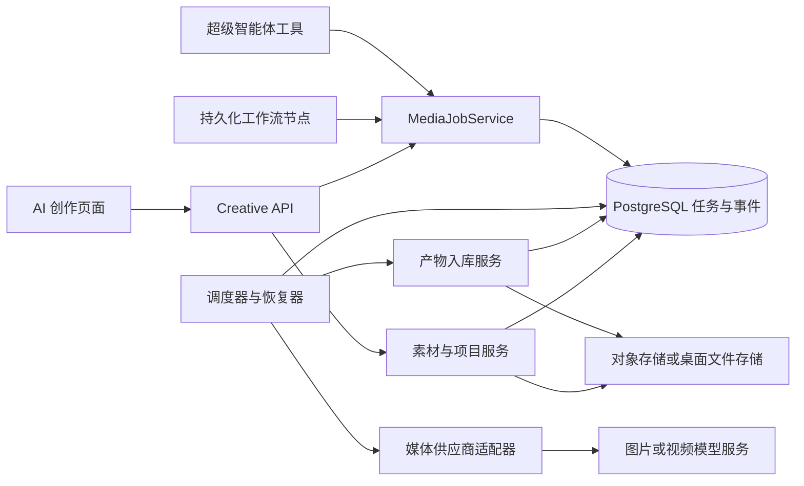

# Aster AI 创作模块：产品与技术详细设计

日期：2026-10-29。状态：设计基线，尚未实现。负责人：Aster 项目。

本文中的新增表、字段、接口、目录、工具名均为**拟议契约**，不是现有能力。现状以第 2 节列出的源码为依据。实施前应重新核对当前分支、数据库迁移序号和供应商最新协议。

配套：[业务实施细则与执行台账](./2026-10-29-ai-creative-implementation.md)｜[分阶段验收标准](../test/2026-10-29-ai-creative-acceptance.md)。2026-10-29 再次核对 HEAD `94a53e8`：图片生成专用绑定已由其他会话实现，本设计相应修订。实施手册对事务、事件顺序、输出槽位、接口和兼容策略的补充决策优先。

## 1. 目标与已作出的决策

用户希望自主掌握幻映 AI 类创作能力，将其作为 Aster 的能力模块，而不是依赖第三方网站转发。

产品名称使用「AI 创作」，技术域名使用 `creative`。沿用 Aster 品牌、登录、工作台外壳和权限体系。幻映 AI 仅作功能参考，不依赖其域名、私有接口、账号、脚本或素材。前序 REA 观察确认了其登录页和公开配置；许多创作能力仅由前端代码推断，不能作为已验证规格。

确定以下取舍：

1. 自研创作系统，生成模型先接正规供应商 API；自建模型推理不在首版范围。
2. Spring Boot 模块化单体 + PostgreSQL 持久化任务；首版不增加 Redis、消息队列或独立微服务。
3. 第一版完成图片创作、任务和素材闭环；视频、自由画布、短剧和成片按后续里程碑交付。
4. 前端继续 Vue 3 + Ant Design Vue，沿用 `--wb-*` 样式令牌和浅／深主题。
5. 先实现 DashScope 图片适配，选定一个通过实测的模型；其他供应商按独立适配器接入。
6. 第一版每次生成一张图；重复点击复用任务，主动“再生成”才创建新任务。批量在后续加入。
7. 图片结果自动进入个人素材库，“收藏”仅改变筛选状态，不要求用户手工保存才能持久化。
8. 媒体任务状态与智能体运行状态分离，所有调用入口共用媒体服务。
9. 浏览器部署使用对象存储；桌面端提供应用数据目录存储。先定义统一存储接口，再实现适配。
10. 不上线充值、支付、积分商城、插件市场或多人实时协作。先记录供应商用量与成本信息。

### 产品完成标准

用户输入想法，选模型并生成图片，离开页面或重启服务后仍能看到任务和结果；可以找回原始提示词与参数，继续创作或下载。智能体与工作流可调用同一能力，结果仍出现在 AI 创作中。

## 2. 现有代码基线与复用边界

| 已核实位置 | 当前事实 | 设计结论 |
| --- | --- | --- |
| `frontend/src/router/index.js` | WorkbenchShell 下挂工作台、超级智能体、工作流、知识库与设置 | 在同一外壳增加 `/creative`，不新增第二套导航 |
| `frontend/package.json` | Vue 3、Ant Design Vue、Vue Flow 已存在 | 后续自由画布复用 Vue Flow 基础设施，独立设计节点数据 |
| `platform/workflow/WorkflowService.java` | 支持 image_generate；固定两线程执行工作流 | 抽出媒体能力；不能直接扩充该大类承载视频与剪辑 |
| 同文件 `imageGenerate` | 已优先 resolveImage，缺失时回退 chat + 节点 model；仅支持 DashScope，每 3 秒轮询、约 120 秒截止 | 复用专用绑定，新增持久化任务；新创作入口取消隐式 chat 回退，旧图显式迁移 |
| `platform/settings/ModelCatalogService.java` | 用途已有 chat/vision/image_generation/embedding；能力仍为 tools/vision/embedding | 复用已有图片用途；新增媒体能力 profile 与校验 |
| `V4__model_provider_catalog.sql` | Provider/Model/Binding；protocol 受 CHECK 约束；模型被级联删除 | 不直接向现有 protocol 塞任意名称；任务独立冻结非敏感快照 |
| `V5__workflow_run.sql` | run 状态 RUNNING/SUCCEEDED/FAILED；步骤/产物 JSONB | 接入长任务前必须增加持久化等待与恢复机制 |
| `knowledge/storage/OssClientProvider.java` | 使用阿里 OSS SDK | 不能把运行环境中的 MinIO 等同于已经实现的 S3 适配 |
| `platform/security/CurrentActor.java` | 请求具备 tenantId、userId、role | 新业务从服务端身份派生归属，不接受客户端指定所有者 |
| `capability/tools/ToolRiskCatalog.java` | 未登记工具默认 EXECUTE | 显式登记媒体工具，并复用现有确认与授权流程 |
| `docs/design/2026-10-29-product-next-phase-plan.md` | 原规划仍有桌面存储、工作流完善等任务 | 本设计新增创作方向，不覆盖原规划和未完成事项 |

已有智能体检查点不能推导为已有工作流或媒体任务恢复。对话模型测试通过也不能推导为生图模型可用。

## 3. 产品范围与分期

| 能力 | P1 图片闭环 | P2 画布与视频 | P3 短剧与成片 |
| --- | --- | --- | --- |
| 创作项目、任务记录、素材库 | 必须 | 增强筛选与关联 | 剧集归档 |
| 文生图、提示词优化 | 必须 | 图生图／编辑按模型支持开放 | 风格与角色模板 |
| 上传参考素材 | 必须；模型不支持时只作素材或提示词理解输入 | 多图参考、首尾帧 | 角色与场景资产 |
| 智能体／工作流调用 | P1 后半段验收 | 多模态编排 | 分镜批量生产 |
| 自由创作画布 | 暂缓 | 文本、参考图、生成与结果节点 | 分镜关联 |
| 视频生成 | 暂缓 | 单镜头文生视频／图生视频 | 多镜头生产 |
| 时间线、字幕、导出 | 暂缓 | 先下载单视频 | 裁切、排序、音轨、字幕、渲染 |
| 支付／积分、实时协作 | 不做 | 不做 | 另立项目评估 |

P1 不承诺局部重绘、抠图、超分、训练 LoRA 或角色绝对一致。这些需要具体模型或算法支持。

## 4. 信息架构与页面设计

### 4.1 路由（拟议）

- `/creative`：最近项目、最近任务、快速开始与配置引导。
- `/creative/projects/:projectId`：创作台，核心操作页面。
- `/creative/assets`：跨项目个人素材库，支持项目／类型／收藏筛选。
- `/creative/tasks`：任务记录，按项目、状态和日期筛选。
- `/creative/tasks/:jobId`：可直接访问的任务详情；创作台内复用相同详情组件。
- `/settings/model`：扩展原页面的“图片生成”用途及能力配置。
- `/creative/projects/:projectId/canvas`：P2 自由画布。

桌面和网页共用路由。桌面依赖现有回环身份，页面不自行构造 JWT 或绕过 CurrentActor。

### 4.2 创作台布局

桌面宽屏：左侧项目内导航约 220px；中央为结果区，占剩余宽度；右侧参数区约 340px。沿用全局侧栏，项目导航仅显示本项目内容，避免重复设置入口。窄屏将参数区收起为抽屉，结果区保留主位。

```text
Aster 全局导航 | 项目：新品视觉       [项目素材] [任务记录]
              |-------------------------------------------
              | 结果区／历史生成          | 创作参数
              |                           | 想法与提示词
              | 图片预览、对比、继续创作   | 参考素材
              |                           | 模型、尺寸
              |                           | [优化提示词]
              |                           | [生成图片]
```

生成按钮旁显示配置状态、输出数量和费用信息。价格未知显示“供应商计费，当前无法估算”，不能显示免费或虚构金额。后台记录存在后即展示任务卡，页面不等待图片生成才响应。

### 4.3 页面状态

| 状态 | 页面行为 |
| --- | --- |
| 无图片模型绑定 | 显示“配置图片模型”，保留已输入草稿 |
| 草稿 | 输入自动保存；不自动生成、不自动优化 |
| 提示词优化中 | 原文可见；完成展示修改前后，用户选用后替换 |
| 排队／提交中 | 显示阶段，允许离开页面，不显示虚构百分比 |
| 生成中 | 展示耗时；只有供应商提供可信进度时才显示百分比 |
| 保存结果中 | 明确区分供应商完成与本平台保存完成 |
| 成功 | 预览、下载、收藏、查看参数、作为下一次参考 |
| 提交结果待确认 | 说明可能已产生供应商任务，提供“查询状态”，不自动重发 |
| 生成失败 | 保留输入，显示可读原因及请求编号；区分修改配置与重新生成 |
| 结果保存失败 | 提供“重新保存”，不再次调用生成模型 |
| 取消中／无法取消上游 | 明确告知取消能力与费用不确定性，不误报已取消 |

### 4.4 交互细节

- 输入原始想法与最终提示词分别存储；优化不覆盖历史。
- 上传素材后先完成校验与入库，得到 assetId 后才允许提交引用。
- 模型切换重新校验参数；不支持的参数提示用户移除，不静默传递。
- 更换参考图只改变草稿；已提交任务输入不可变。
- 结果“继续创作”复制输入并记录父素材；“相同参数再生成”生成新幂等键。
- 任务卡重复加载按 jobId 合并；刷新页面不重复提交。
- 支持键盘访问、输入标签与状态播报；核心按钮文字明确，不能只用图标。
- 第一版个人使用：项目列表仅本人可见；管理员不因角色自动获得他人素材读取权限。

## 5. 核心用户流程

### A. 首次配置与生成

选择图片用途 → 配置供应商与模型 → 非计费配置校验 → 用户显式发起最小生成测试 → 回创作台输入提示词 → POST 创建任务 → 后台执行 → 保存产物 → 预览下载。

配置检测和真实生成测试分开。供应商未提供无费用探测时明确显示限制；不因点击普通“测试连接”偷偷生成图片。

### B. 提示词优化

输入想法 → 调用已有对话模型 → 获得 optimizedPrompt、changes、assumptions → 用户选择采用／保留原文 → 生成。优化失败不影响手工生成。P1 用途回退到 chat，不新建独立供应商体系。

参考图理解只在用户选择该动作且配置 vision 模型后发生；无法读取图片时不把文本猜测包装为图片理解。

### C. 智能体发起

用户请求图片 → 智能体组织参数 → 按现有权限级别执行确认 → 创建媒体任务并立即返回 jobId → 展示任务卡 → 状态由前端／后台订阅刷新 → 产物进入创作模块。禁止让模型不停调用查询工具形成空转循环。

### D. 服务重启

启动恢复器扫描到期任务 → 有 providerTaskId 的任务恢复查询 → 结果保存任务继续入库 → 提交中断且无法判断上游是否接受的任务进入 RECONCILING → 查询依据不足时停留并提示，不自动提交第二次。

## 6. 服务架构与模块边界



建议新增包 `com.zwx.zwxagent.creative`，内部按职责划分：

| 子包 | 职责 |
| --- | --- |
| `project` | 创作项目、草稿、归档与版本冲突 |
| `job` | 创建、调度、租约、状态迁移、恢复、事件 |
| `provider` | 能力描述、输入校验、提交、查询、可选取消 |
| `asset` | 素材元数据、引用血缘、下载授权、缩略图 |
| `storage` | OSS／本地适配；S3 后续按需增加 |
| `prompt` | 提示词优化、版本和使用记录 |

Controller 延续 `web/controller`，工具延续 `capability/tools`。不另建应用启动类，不要求首版 MCP 服务拆分。用接口和领域 DTO 隔离供应商响应，不把厂商 JSON 传遍前后端。

## 7. 模型目录与供应商适配

### 7.1 目录增量

- 复用已存在的 purpose：`image_generation`；P2 再增加 `video_generation`。
- 增加 capability：`image_generation`、`image_reference`、`image_edit`；P2 增加 `video_generation`、`video_reference`。
- 模型能力必须由适配配置和验收决定，不能仅凭名称猜测。
- 新增 `media_model_profile`，与现有 model_provider_model 关联：adapter_key、adapter_version、operations、parameter_schema、limits、verified_at、verification_status、price_metadata、revision。
- `parameter_schema` 只表达 UI 与校验规则；实际字段映射在受控适配代码内，不允许后台上传任意执行脚本。
- 保留现有 Provider protocol 的含义。媒体 adapter_key 独立于 chat protocol；已有 dashscope 可复用其凭据，不能假设 openai-compatible 一定兼容生图接口。
- 解析顺序：用户专用绑定 → 系统专用绑定 → 明确配置的媒体回退；不再隐式借用 chat。
- 检查 binding 的模型确属对应 provider，且当前调用者拥有使用权限。

### 7.2 拟议适配器接口

```text
capabilities(profile) -> 操作、参数范围、取消与幂等支持
validate(input, profile) -> 校验结果
submit(input, credential, submissionKey) -> Accepted(taskId) | Completed(outputs) | Rejected | Unknown
query(taskId, credential) -> 状态、结果、usage、下一次查询建议
cancel(taskId, credential) -> Confirmed | Requested | Unsupported | Unknown
```

所有网络调用设连接／响应超时。支持同步返回图片的模型直接进入 FETCHING；异步模型必须持久化上游 taskId 后查询。baseUrl 的版本路径和媒体路径由适配器构造，不沿用聊天路径拼接规则。

快照冻结 providerId、modelRowId、模型名称、endpoint、适配版本、能力版本、请求参数、目录修订号；不记录密钥明文。查询时复用同一 provider 的当前有效凭据，禁用／删除后显示配置阻塞，不能自动切到另一个账号或模型重发。活动任务关联的 provider/model 禁止硬删除，完成后可保留脱敏历史快照。

## 8. 媒体任务状态机与可靠性

### 8.1 状态与合法迁移

| 状态 | 含义 | 后继 |
| --- | --- | --- |
| QUEUED | 本地已受理、未发出生成请求 | SUBMITTING、CANCELLED |
| SUBMITTING | 正在向供应商提交 | RUNNING、FETCHING、FAILED、RECONCILING |
| RECONCILING | 请求可能已受理，但没有可靠结果 | RUNNING、FETCHING、FAILED；证据不足保持原状 |
| RUNNING | 已有上游任务标识 | FETCHING、FAILED、CANCEL_REQUESTED |
| CANCEL_REQUESTED | 已请求取消，上游尚未确认 | CANCELLED、RUNNING、FETCHING、FAILED |
| FETCHING | 上游已完成，正在下载／持久化结果 | SUCCEEDED、INGEST_FAILED |
| INGEST_FAILED | 生成成功但本地结果尚未可靠保存 | FETCHING |
| SUCCEEDED | 产物已持久化并可授权读取 | 终态 |
| FAILED | 已确认生成拒绝／失败 | 终态；重新生成创建新 job |
| CANCELLED | 未提交即取消，或供应商确认取消 | 终态 |

配置问题单独记录 `blocked_reason`，不丢失 RUNNING 等上游阶段；修复后继续原任务。超过本地查询观察期限记录 `attention_required`，降低查询频率，不将上游未知状态伪装成失败。

取消与生成完成竞态：若结果先完成，进入 FETCHING 并保留 cancellationOutcome；不丢弃已产生费用的结果。供应商不支持取消时告知用户，继续跟踪结果。P1 无批量；P2 批量由多个子 job 聚合，不向单任务塞部分成功语义。

### 8.2 提交幂等与不可消除的不确定性

- 创建事务写入 job + 初始 event；唯一键 `(tenant_id,user_id,idempotency_key)`。
- 请求正文规范化后计算 request_hash。同键同内容返回原 job，同键不同内容返回 409。
- 一个 workflow 节点或 agent toolCallId 派生稳定业务幂等键；浏览器一次点击生成一个键，网络重试复用。
- 提交前在短事务中写入 attempt 与 submission_key，再在事务外发 HTTP。
- 上游返回 taskId 后，短事务更新 job 与 attempt。如果响应丢失或进程在返回后落库前退出，进入 RECONCILING。
- 支持上游幂等键／客户端请求号查询时用于对账；不支持时**无法保证外部副作用 exactly-once**。默认不自动重发可能成功的请求。
- 重新生成是新 job，记录 parent_job_id，并在待确认旧任务存在时提示可能重复计费。
- GET 查询、素材下载可重试；POST 生成仅在确认未发送、明确拒绝且允许重试，或上游幂等保证下重试。HTTP 5xx 不自动等于未受理。

### 8.3 调度与并发

首版 PostgreSQL 就绪队列：按 next_action_at 批量选取，`FOR UPDATE SKIP LOCKED` 抢占；短事务写 lease_owner、lease_until、lease_epoch，立即提交。调用供应商时不占数据库锁。

建议初始参数：调度周期 1 秒，租约 60 秒、每 20 秒续约，外部调用默认 30 秒；这些是可调默认值，需要压测验证。提交与查询使用分离的有界线程池，避免等待生成占满工作流线程。

所有 worker 更新带 jobId + lease_epoch + version 条件，过期 worker 不能覆盖新状态。提交租约过期只进入对账，不由新 worker 无条件再提交。查询租约过期可重新查询。

每用户默认 2 个在途任务、每供应商默认 4 个、全局默认 8 个，队列上限每用户 20；配置可调整。以 PostgreSQL 配额行锁在提交前原子占用槽位，结束时释放，恢复器对账，不能只使用单进程 Semaphore。限制按上游在途任务计，QUEUED 不占供应商槽位。

查询按 3 秒起步退避至 15 秒，叠加抖动；尊重 Retry-After。查询失败不新建生成任务。RECONCILING 按配置保守保留槽位并提示处理，避免静默释放导致并发失控。

### 8.4 结果入库一致性

按 jobId + outputIndex 使用确定性对象键；流式下载到临时对象／文件，校验大小、媒体类型和摘要后完成写入，再事务写素材记录和 SUCCEEDED 事件。生成成功但下载失败进入 INGEST_FAILED，重新保存只重试获取结果。

若对象已写而 DB 事务失败，重试校验对象并补元数据；定期扫描无引用的临时对象并延时清理。来源 URL 过期优先通过上游 taskId 刷新结果；无法恢复时明确提示，不能偷偷重新生成。

## 9. 数据模型（拟议字段与约束）

ID 使用 UUID 字符串以兼容现有项目习惯；时间使用 TIMESTAMPTZ；状态字符串有 CHECK；可变记录包含 version 乐观锁。所有业务实体包括 tenant_id、user_id，服务查询必须附归属条件；用户归属一致性采用组合唯一键／外键或事务校验，不只检查前端。

| 表 | 主要字段 | 关键约束／索引 |
| --- | --- | --- |
| creative_project | id, tenant_id, user_id, name, description, status(ACTIVE/ARCHIVED), version, created_at, updated_at | `(tenant_id,user_id,updated_at)`；项目归档不取消任务 |
| creative_draft | id, project_id, tenant_id, user_id, operation, original_prompt, effective_prompt, reference_asset_ids JSONB, model_row_id, parameters JSONB, version, updated_at | 项目与所有者一致；更新带 expectedVersion |
| media_model_profile | id, model_row_id, adapter_key, adapter_version, operations JSONB, parameter_schema JSONB, limits JSONB, verification_status, verified_at, price_metadata JSONB, revision | model_row_id 唯一；供应商配置权限沿用目录 |
| media_job | id, project_id, tenant_id, user_id, source_type, source_run_id, source_node_id, parent_job_id, operation, status, idempotency_key, request_hash, input_snapshot JSONB, model_snapshot JSONB, provider_id, provider_task_id, submission_key, version, next_action_at, lease_owner, lease_until, lease_epoch, blocked_reason, attention_required, error_code, error_summary, cancel_requested_at, created_at, updated_at, finished_at | 用户幂等唯一；非空 provider_task_id 按 provider_id 唯一；活跃状态/next_action_at 部分索引；归属/created_at 索引 |
| media_job_attempt | id, job_id, attempt_no, action(SUBMIT/QUERY/CANCEL/FETCH), request_id, outcome, http_status, error_code, started_at, finished_at | `(job_id,attempt_no)` 唯一；诊断不保存凭据及完整大响应 |
| media_job_event | seq BIGSERIAL, job_id, tenant_id, user_id, event_type, payload JSONB, created_at | `(job_id,seq)`；payload 脱敏；与状态更新同事务 |
| creative_asset | id, project_id, tenant_id, user_id, source_job_id, output_index, origin(UPLOAD/GENERATED/DERIVED), media_type, storage_backend, object_key, mime_type, byte_size, sha256, width, height, duration_ms, display_name, starred, status, metadata JSONB, created_at, deleted_at | `(source_job_id,output_index)` 非空唯一；归属/项目/创建时间索引；签名 URL 不落库 |
| creative_asset_link | id, tenant_id, user_id, source_asset_id, target_asset_id, job_id, relation(REFERENCE/DERIVED_FROM/THUMBNAIL_OF) | 关系复合唯一；关联素材必须属于同一授权范围 |
| media_usage_record | id, job_id, tenant_id, user_id, usage_source, usage_json, estimated_amount, actual_amount, currency, pricing_revision, created_at, updated_at | job_id 唯一；金额 DECIMAL，未知值 NULL，不能用 0 代替未知 |
| media_provider_quota | provider_id, max_inflight, updated_at | 锁定行控制供应商额度；系统／用户限制用同类 scope 配额记录实现 |

P1 每个素材归属一个项目。跨项目“使用参考”允许本人授权引用，不移动原件；若原件在用，禁止物理删除。后续共享项目需显式 membership 表，本版不隐式开启租户共享。

生命周期：归档项目仍可查询任务；删除素材先软删除，活动任务和派生引用需明确提示。物理清理只针对无活动引用、超过保留期的对象。草稿更新冲突返回 409，客户端提供重新加载与另存副本。

P2 新增 creative_canvas（document JSONB、schema_version、version）及 canvas_revision；P3 再新增 story、episode、character、shot、timeline、render_job 等业务表，不提前落空表。

## 10. API 契约

以下路径包含项目已有 `/api` 上下文前缀；Controller 中只写 `/ai/creative`。返回 JSON 沿用现有应用风格；错误由统一异常处理映射，不另包一层与现有接口冲突的 envelope。

| 方法 | 路径（/api/ai/creative 前缀） | 用途 |
| --- | --- | --- |
| GET / POST | `/projects` | 分页列表／创建项目 |
| GET / PATCH | `/projects/{id}` | 详情／更新、归档；更新带 expectedVersion |
| GET / POST | `/projects/{id}/drafts` | 草稿列表／创建 |
| GET / PATCH | `/drafts/{id}` | 读取／更新草稿 |
| GET | `/models?operation=text_to_image` | 可用模型与验证过的参数约束，不返回密钥 |
| POST | `/prompt-optimizations` | 优化提示词；不自动提交生图 |
| POST | `/jobs` | 创建任务；Idempotency-Key 请求头必填 |
| GET | `/jobs?projectId=...&status=...&cursor=...&limit=20` | 归属内分页，limit 上限 100 |
| GET | `/jobs/{id}` | 状态、产物、可执行操作、诊断摘要 |
| POST | `/jobs/{id}/cancel` | 请求取消；返回真实状态与可取消性 |
| POST | `/jobs/{id}/retry` | 明确的新生成任务；新幂等键，返回新 jobId |
| POST | `/jobs/{id}/recover-result` | 重试保存结果，复用原 job，不调用生成 |
| GET | `/jobs/{id}/events?after=123` | SSE：持久事件回放与后续状态 |
| POST | `/assets/uploads` | multipart 图片上传并入库 |
| GET | `/assets` | 项目、类型、收藏筛选 |
| GET / PATCH / DELETE | `/assets/{id}` | 元数据／名称收藏／软删除 |
| GET | `/assets/{id}/content` | 授权流式读取，或服务端生成短期跳转地址 |

拟议创建请求示例（参数值仅说明结构，实际尺寸由模型能力定义）：

```json
{
  "projectId": "<项目 UUID>",
  "operation": "text_to_image",
  "modelRowId": 123,
  "originalPrompt": "做一张咖啡新品海报背景",
  "effectivePrompt": "暖色摄影风格的咖啡静物，主体右置，左侧留白，不添加文字",
  "parameters": {"size": "1024*1024", "count": 1},
  "referenceAssetIds": [],
  "draftId": "<草稿 UUID>"
}
```

成功返回 HTTP 202：`{jobId,status:"QUEUED",createdAt,links:{self,events}}`。幂等复用返回原任务并标记 reused；不制造第二个 job。400 参数格式错误，401 未登录，404 资源不存在或不属于调用者，409 幂等／版本／状态冲突，422 模型能力不支持，429 本地配额受限。上游故障以已创建任务的 errorCode 呈现，不伪装成 HTTP 创建成功即生成成功。

SSE：事件 id 使用 seq；状态事务提交后通知，丢通知可依靠数据库补拉。每条包含 jobId、type、version、data；前端按 id 去重。现有 JWT 由 fetch 流式请求携带 Authorization，避免把 token 放查询参数；同源桌面身份沿用现有机制。保留期外游标触发 reset + 最新快照，再继续订阅。可见页面 SSE 失败退化为 5 秒轮询，页面隐藏降频。

## 11. 素材与存储

新增 MediaStorage 接口：put(stream,metadata)、open(key)、stat(key)、delete(key)，返回稳定 storageKey 和摘要。P1 云端实现 OSS、桌面实现 LocalMediaStorage；需要 MinIO 时另写 S3 适配并验收，不能直接套 OSS SDK。

- 对象键采用 `creative/{tenantId}/{userId}/{projectId}/{assetId}/original.ext`；生成资产 ID 在入库前确定并持久化，重试复用。
- 桌面保存在 Electron 配置的应用数据根下；路径由后端决定，拒绝穿越和符号链接逃逸。数据库保存相对 key，不保存本机绝对路径。
- 桌面前端通过授权内容接口读取，不依赖 file://；导出到用户目录走已有目录授权能力。
- 上传初始上限建议单图 20 MiB、像素总量 40 MP、单任务一张输出；P2 视频单独定限，不沿用图片内存读取。
- 检查文件签名、MIME 和解码尺寸，拒绝不支持格式；缩略图独立派生，失败时保留原件并显示占位。
- 下载供应商结果实行流式限额、逐跳 URL 校验、超时、受控公网访问；临时 URL 查询参数可能带签名，日志需脱敏。
- 给供应商参考图使用短期签名地址或供应商上传接口，按适配器处理。桌面 localhost 不可直接作为云端可访问参考图 URL。
- 本地来源若模型只接受公网 URL，UI 明示需配置对象存储／上传能力；不自动把本机服务暴露到公网。
- 网页和桌面数据库独立，P1 不包含自动云同步。备份必须同时覆盖数据库与媒体目录，避免只有元数据。

## 12. 接入超级智能体与工作流

### 智能体工具（拟议）

`createMediaJob`：生成外部费用，登记 EXECUTE，继承五档权限和确认策略；`getMediaJob`、`listCreativeAssets`：READ_ONLY；`cancelMediaJob`：EXECUTE。工具结果用 jobId、assetId、状态与简短摘要，不返回 base64 大图或供应商密钥。

权限在工具入口与服务层都校验。sourceRunId/toolCallId 从可信执行上下文提供，不能让模型指定另一用户的运行。相同 toolCallId 重放复用原任务；如有用户数量／预算限制，每次提交必须校验，不能将一次允许扩展成无限生成。

### 工作流：先完成等待恢复，再迁移节点

现有 workflow_run 仅三种状态、步骤 JSONB，不能把异步媒体任务 ID 当作图片结果交给下游。

P1 后半段新增 workflow_node_execution：run_id、node_key、status、media_job_id、output_json、version、lease字段，`(run_id,node_key)` 唯一；run 状态增加 WAITING_EXTERNAL，节点增加 WAITING_EXTERNAL。运行在启动时冻结 graph/input/version，而非恢复时读取最新定义。

image_generate 节点提交媒体任务后持久化 jobId 并让出执行线程。恢复器／事件消费器发现媒体任务成功后，事务写节点结果，并将后续可执行节点重新调度。多个 worker 并发通过节点版本与租约保证只推进一次。

节点类型增加 `media_image_generate`（P1）、`media_video_generate`（P2），输出结构为 `{jobId,assets:[{assetId,mediaType}]}`。旧图中的 image_generate 保留历史执行路径与模型回退；用户升级定义版本时替换为新媒体节点并要求图片用途绑定。转换旧消费者时新增受控资产引用解析，不能直接把 JSON 填入旧的 image 参数。

具体兼容验证：image_understand、poster_render 的输入解析新增 assetId 引用支持，由后端读取受权图片；保留旧 URL 路径，不持久化即将过期的签名 URL。实施定稿采用旧节点保留、新版本显式升级为 media_image_generate 的策略（见实施手册 C14），不静默改变已保存图。

升级时旧运行仍按其历史执行路径读取；新执行启用媒体节点开关。不得声称原工作流所有外部副作用都已 exactly-once；本阶段只保证新增媒体节点的幂等接入。

## 13. P2 自由画布与视频设计

创作画布独立于工作流 DAG：节点包含 Prompt、ReferenceAsset、ImageGeneration、VideoGeneration、Result、Note；边类型为参考、提示词上下文、派生，不是每条线都自动执行。

- 布局文档只保存位置、尺寸、节点 ID、资产引用和草稿参数；不存媒体二进制。
- 点击生成时冻结该节点的输入快照与依赖资产。后续拖动、改提示词不改变在途任务。
- 节点显示最近 jobId 与状态；结果以独立资产节点出现，历史结果可追溯。
- 保存使用 schemaVersion + optimistic version；多人协作推迟，冲突提供另存副本。
- 执行子图时拒绝循环和无法满足的输入；仅执行选中的依赖范围，并展示预计生成数量。
- 视频沿用媒体任务，加入 duration、resolution、aspectRatio、firstFrameAssetId 等经模型支持验证的参数。
- 视频完成后派生封面与元数据；支持 Range 读取，避免整段加载到内存。

## 14. P3 短剧、角色与成片设计

业务结构：CreativeProject → Story → Episode → Shot；Character 和 SceneAsset 可供多个 Shot 引用，引用的是明确资产版本。每个 Shot 保存台词、镜头说明、时长意图、参考素材、图片／视频任务和已选结果。

剧情拆解采用结构化输出 + 人工编辑确认；批量生成前展示镜头数、模型和预算信息。角色一致性通过固定参考素材、版本、提示词约束及支持参考的模型提高，不作绝对一致承诺。

时间线保存 Track/Clip，Clip 引用不可变资产版本并记录 trimIn、trimOut、start、volume；字幕使用有时间码的独立轨道。渲染任务冻结 timelineVersion、编码配置和素材版本。

正式成片建议受控 FFmpeg worker：云端独立进程并限 CPU／内存／时长；桌面按架构打包并核验工具许可与可执行文件。浏览器先承担预览和简单交互，WASM 导出作为可选增强，不承诺长视频稳定性。首版成片验收从少量短片段、单视频轨和字幕开始，后续再加转场、配音与复杂音轨。

## 15. 隔离、费用与诊断

- 所有 API、事件流、下载、任务查询、素材引用均按 tenantId + userId 校验；猜测 UUID 不能越权。
- 限流区分用户、供应商和全局；生成数量与参考图数量在服务端硬校验。
- estimatedAmount 与 actualAmount 分开；供应商未返实际费用则保持 NULL，并标记来源。请求超时不等于未扣费，取消不保证退款。
- 首版采用供应商自身限额 + 本地并发／次数限制；未知价格时无法保证金额硬预算，不宣传“绝不会超预算”。
- 日志记录 jobId、attemptId、provider requestId、状态迁移与耗时；不保存 Authorization、签名 URL、原图 base64。
- 指标：队列等待、提交时延、在途数量、对账滞留、成功率、保存失败率、租约失效率、按供应商错误分布。
- 重要错误码：MODEL_NOT_CONFIGURED、UNSUPPORTED_PARAMETER、PROVIDER_AUTH_FAILED、PROVIDER_RATE_LIMITED、SUBMISSION_UNCERTAIN、RESULT_FETCH_FAILED、STORAGE_UNAVAILABLE、CANCEL_UNSUPPORTED、ASSET_ACCESS_DENIED。
- 用户错误提示含可操作建议；仅后台授权诊断查看脱敏技术详情。

## 16. 实施顺序与交付门槛

不承诺未经实际开发验证的日历工期。按可验收批次交付，上一批可靠性通过后再扩大功能。

| 批次 | 具体交付 | 必须满足的退出条件 |
| --- | --- | --- |
| M0 契约与试验 | 确认一个真实图片模型、最新官方协议、测试凭据、参数和收费；Mock adapter | 模型 ID、路径、响应／取消／幂等能力有依据；未实测项明确标记 |
| M1 媒体底座 | 迁移、模型 profile、任务／attempt／event、调度租约、Mock provider | 重复提交、断网、重启、并发竞争测试通过 |
| M2 存储与真模型 | OSS／LocalMediaStorage、素材入库、DashScope adapter | 一次真实生成可入库；保存失败不重生成；桌面与网页分别验证 |
| M3 创作页面 | 项目、草稿、参数、任务卡、素材列表、提示词优化 | 完整图片闭环，刷新／离开／主题切换／错误状态可用 |
| M4 Aster 融合 | 智能体工具、工作流持久化等待与兼容、工作台统计 | 页面、智能体、工作流都调用同一服务，无重复费用请求 |
| M5 P2 | 视频 adapter、视频素材、独立自由画布 | 单镜头视频真实完成、重启恢复、资产参考校验 |
| M6 P3 | 剧集／角色／镜头、时间线、FFmpeg 渲染 | 小型短片完整导出，字幕与音画基础验收 |

第一阶段发布范围为 M0–M4，对应实施手册 C00–C16（包含存储、桌面与发布验收）。M0 若缺真实供应商账号可继续 Mock 底座和 UI，但不能将此记为真实生图验收通过。主分支已存在 V1–V7 迁移，新增编号在实施时重新确认，不预占 V8。

### 拟议文件落点

- 前端：`views/creative/CreativeHome.vue`、`CreativeStudio.vue`、`CreativeAssets.vue`、`CreativeTasks.vue`。
- 组件：`components/creative/PromptEditor.vue`、`ModelParameterForm.vue`、`MediaJobCard.vue`、`AssetPreview.vue`、`MediaJobDetail.vue`。
- API：新增 `frontend/src/api/creative.js`，复用现有认证请求约定。
- 后端：`creative/job/MediaJobService.java`、`MediaJobScheduler.java`、`MediaJobRecoveryService.java`、`creative/provider/MediaProviderAdapter.java`、`DashScopeImageAdapter.java`、`creative/asset/AssetIngestService.java`、`creative/storage/MediaStorage.java`。
- Controller：`CreativeProjectController`、`CreativeJobController`、`CreativeAssetController`。
- 配置：新增独立默认配置项 creative.enabled、队列／上传限制等；不要改写 application-local.yml。真实凭据通过已有模型设置提供。

## 17. 验收矩阵

| 测试 | 预期 |
| --- | --- |
| 同一幂等键并发请求 20 次 | 一条 job；上游最多一次有效提交 |
| 相同键但不同提示词 | 409，无第二个提交 |
| 提交已接受但响应断开 | RECONCILING；不盲目补发 |
| 保存 providerTaskId 后重启 | 恢复查询原任务，无新生成 |
| 提交响应后、落库前崩溃 | 有上游对账依据则恢复；否则保持不确定 |
| 租约过期旧 worker 回写 | 被 epoch/version 条件拒绝 |
| 多实例同时抢额度 | 不超过定义的提交额度；取消／终态释放可对账 |
| 生成成功但存储故障 | INGEST_FAILED，恢复后保存同一结果 |
| 对象写成功、DB 提交失败 | 重试复用对象，素材不重复 |
| 上游结果 URL 过期 | 尝试重新查询，不能暗中重生成 |
| 取消与结果同时到达 | 收敛到有证据的状态，结果不丢失 |
| SSE 中断、重复、过期游标 | 去重重连，必要时重取快照，状态不回退 |
| 不同用户读取 job／asset／events | 全部拒绝，响应不泄露归属 |
| 供应商返回内网下载地址／重定向 | URL 策略拦截，任务给出明确错误 |
| 模型删除或 Key 轮换 | 活动任务保护，配置阻塞可恢复，不切换账号重发 |
| 工作流等待期间重启 | 原 job 接续，后继节点只推进一次 |
| 桌面无 OSS 配置 | 本地生成结果可保存下载；公网参考图限制有提示 |
| 旧工作流与对话回归 | 原图可读取，旧接口兼容，不改变对话模型绑定 |

Mock HTTP 服务覆盖同步／异步成功、429、401、5xx、不确定提交、慢响应和坏文件。关键数据库并发测试使用 PostgreSQL，不用内存数据库替代 SKIP LOCKED 行为。真实供应商烟测单独执行并记录费用，不放入普通 CI。

前端按创建项目→保存草稿→生成→断线刷新→预览下载→继续创作做浏览器验收；浅／深主题、窄屏、键盘操作均检查。构建遵循仓库规定：后端用 mvn，桌面资源需独立重打包。

## 18. 发布、回滚与待验证事项

新增功能使用服务端开关 creative.enabled；关闭入口和新提交时，仍允许运行任务查询／保存，避免关闭开关丢任务。灾难停机另提供暂停调度控制，不混同 UI 功能开关。

迁移只做增量，新表与旧表字段扩展先于新代码启用。旧节点迁移另设开关和兼容层；回滚前停止新任务、记录活跃任务、保留后台收尾版本。只回退前端不删除媒体表／文件。数据库与存储同时备份，回滚脚本不能清空生成结果。

待验证事项不阻止设计，但决定实现时的具体参数：

1. 首个供应商的真实模型 ID、区域、路径、尺寸、参考图规则、取消与幂等保证、当前价格：M0 根据官方文档和真实请求确认。
2. 本机与服务器可用的对象存储配置、容量与备份策略：实施时检查配置状态，不将密钥写入文档。
3. 现有桌面存储是否在其他会话完成：接手实施时重新审查，优先复用已交付的适配。
4. 工作流恢复和权限功能可能继续变化：本设计与当日代码对齐，实施前以最新源码为准。
5. 第一版用一张输出控制复杂度；放开批量、金额硬预算、多租户共享前必须分别补充设计和验收。

最终目标是“一个创作模块、多个调用入口、一套可信任务与素材数据”。自由画布与短剧是这个底座之上的产品扩展，不另建互不相通的生成链路。
