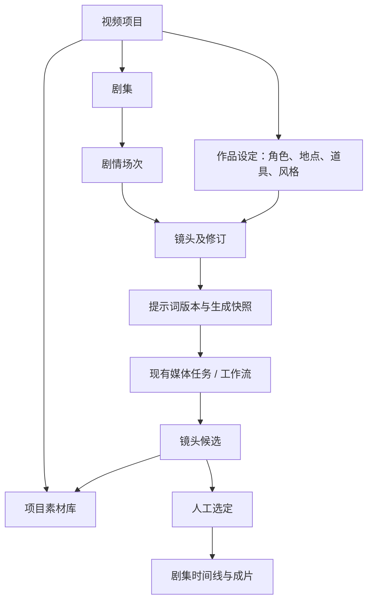

# 视频创作完善：项目素材、剧集剧情、任务与提示词统一管理

日期：2026-11-01。性质：源码核对、官方资料调研及实施建议；本文新增能力均为规划，未实施。

基线：HEAD `e3caabd` + 工作区已有的视频生成改动。用户已明确“视频生成模块已经打通”，本方案从可用的视频生成继续完善。原视频方案中的“VIDEO 未开放”等描述是历史基线，不用于本次判断。

承接：[视频与剧情产品方案](2026-11-01-video-story-product-architecture.md)、[执行计划](2026-11-01-video-story-implementation-plan.md)、[验收标准](2026-11-01-video-story-acceptance.md)。本方案细化并调整 S01–S03：提前支持多剧集组织；基础生成能力维护与剧情管理可独立推进。

## 1. 推荐决策

1. **视频项目需要专属素材库视图，底层继续复用 creative_asset 和现有存储。** 视频、参考图片、关键帧属于同一个项目资源体系；音频和字幕在对应能力落地时扩展。
2. **内容主轴采用项目 → 剧集 → 场次 → 镜头。** 单条生成保留轻量入口，未编入剧情的素材进入“未归类”。
3. **素材、角色、地点是复用资源，剧集、场次、镜头通过关联使用它们。** 同一角色参考图可以服务多集，不必复制多份；素材文件夹不承担剧情关系。
4. **统一展示创作任务和执行记录，但保持职责清楚。** “完善第三镜头”是创作事项；一次供应商调用是 MediaJob；一次流程执行是 WorkflowRun。复用已有执行引擎。
5. **提示词优化改为有上下文、可对比、可部分采纳的创作助手。** 保存结构化剧情与镜头细节，再按模型能力生成提交文本；禁止自动改写已确认事实或静默触发生成。
6. **先做组织与单镜头闭环，再做批量生产，最后做成片。** 不以重做供应商接入、重建画布或先做完整剪辑器作为前置条件。

默认产品假设：个人创作者、短剧情/短剧、多集连续创作；协作排班、多季、分支剧情和复杂多轨剪辑暂不作为首版要求。剧集数、镜头数和候选数使用可配置限额，不把示例数字当作用户硬要求。

## 2. 调研证据与适用边界

以下为 2026-11-01 实际阅读的官方页面，搜索摘要只用于定位。调研覆盖公开产品说明和提示词指南，未登录试用竞品，也未实测其生成效果。

| 官方来源 | 阅读到的事实 | 对 Aster 的启示 |
| --- | --- | --- |
| [Kitsu：Production Structure](https://kitsu.cg-wire.com/guides/production-structure/) | production 下组织 episode/sequence/shot；shot 是镜头任务的主要容器，制作实体与任务跟踪交叉组织 | 内容层级与任务状态分别建模；短剧首版可用“场次”组织镜头，不照搬所有制片部门 |
| [Kitsu：Breakdown & Casting](https://kitsu.cg-wire.com/guides/production/breakdown-casting/) | 将角色、背景等资产关联至镜头，也能在分镜前关联到一集或多集；存在全局资产库复用 | 用关联表达“本集使用什么”，角色和场景资源不应成为某一集的私有副本 |
| [Google Flow：项目、素材和集合](https://support.google.com/flow/answer/16935308?hl=en) | 项目内按图片、视频、角色、场景、上传等筛选；可检索和过滤；集合可嵌套；角色能组织成可复用参考 | 独立项目素材视图 + 业务分类 + 集合；页面宣称的角色一致性不作为 Aster 的效果保证 |
| [Google Flow：创建视频](https://support.google.com/flow/answer/16353334?hl=en) | 可选择项目中的参考素材，提示词说明参考用途；强调文本和图像不冲突、参考风格一致、素材主体干净 | 保存参考角色和使用目的；本地素材 ID 通过适配器映射为供应商认可的引用 |
| [Runway：Gen-4 Video Prompting Guide](https://help.runwayml.com/hc/en-us/articles/39789879462419-Gen-4-Video-Prompting-Guide) | 图生视频从简洁运动描述开始，逐步增加主体/镜头/环境运动与风格；建议正向表达 | 优化结果不是越长越好；这些建议针对该模型，不能变成所有模型统一规则 |
| [火山引擎：Seedance 2.0 提示词指南](https://docs.volcengine.com/docs/ark/seedance-2-0-prompt-guide?lang=zh) | 明确主体指代、动作部位/幅度/速度、动作承接、情绪外化；单镜头尽量一种运镜；推荐事件顺序，提醒精确秒数控制不稳定；参考素材按功能区分 | 将剧情细节变成可拍摄的动作；按模型编译引用与约束，保留顺序和镜头意图；不把整部剧本塞进一次生成 |

**边界：**火山官方模型能力不等于当前 KKAI 中转通道已暴露相同参数。本地已核实 text_to_video；参考图传输、音频、视频延长、多参考、精确画幅仍按供应商实测状态开放。官方网页更新后能力可能变化，模型配置应记录证据日期与适配器版本。

调研中有明确差异：Runway Gen-4 倡导避免否定提示，Seedance 文档提供约束语句；Seedance 文档支持有序多镜头描述，但也提醒不要直接提交冗长完整剧本。因此应建立模型专用提示模板，而非统一“万能提示词”。

## 3. 当前实现与差距

| 核对对象 | 当前事实 | 本轮需要补齐 |
| --- | --- | --- |
| CreativeAssetRecord / CreativeAssetRepository | 有 projectId、tenantId、userId、sourceJobId、mediaType、尺寸/时长和哈希；列表支持项目筛选 | 剧集/场次/镜头关联、角色用途、标签、候选/选定、来源链展示 |
| CreativeProject.vue | 已有创作、工作流、任务记录、素材库；视频项目复用素材视图 | 剧集导航、剧情/分镜工作区、上下文筛选、独立业务组件 |
| creative_asset_link / media_job_asset_ref | 分别保存素材间关系与任务输入引用 | 扩展剧情业务引用；不要把现有素材间关系误作镜头归属 |
| MediaJob / InputSnapshot / ModelSnapshot | 已有媒体生命周期、输入及模型快照、来源、重试与转存恢复 | 镜头修订/提示词版本/批次子项关联、候选回写与统一任务视图 |
| PromptOptimizationService | SYSTEM 仍是“文生图提示词编辑”；请求只有 prompt，返回原文、改写文、模型名 | 视频专用策略、项目和镜头上下文、修改说明、锁定字段、版本快照 |
| NovelPlanningService | 读取设定、章节目录与近几章概要，提供剧情候选 | 不能直接代替视频剧本服务；导入时冻结已确认小说内容，建立独立剧集剧本 |
| 创作领域目录 | 当前找到 novel、video 等模块，未找到剧情剧集/场次/分镜/批次领域实现 | 按阶段新增，不把旧规划当作现有功能 |

现有项目归属和用户授权是可复用基础，但“按项目过滤列表”不等于所有入口已执行严格的跨项目引用隔离。新接口应逐项验证父子关系和素材归属，覆盖同一用户的不同项目。

主要源码入口：

- `src/main/java/com/zwx/zwxagent/creative/domain/CreativeAssetRecord.java`
- `src/main/java/com/zwx/zwxagent/creative/repository/CreativeAssetRepository.java`
- `src/main/java/com/zwx/zwxagent/creative/service/PromptOptimizationService.java`
- `src/main/java/com/zwx/zwxagent/web/controller/CreativePromptController.java`
- `src/main/java/com/zwx/zwxagent/creative/service/MediaJobService.java`
- `src/main/java/com/zwx/zwxagent/creative/domain/InputSnapshot.java`
- `src/main/java/com/zwx/zwxagent/creative/novel/NovelPlanningService.java`
- `frontend/src/views/creative/CreativeProject.vue`
- `src/main/resources/db/migration/V8__creative_p1_tables.sql`

## 4. 内容组织：项目、剧集、场次、镜头

### 4.1 概念与必需信息

以下均为建议业务对象和字段含义，表名/API 尚未实施。

| 对象 | 主要信息 | 关键规则 |
| --- | --- | --- |
| 视频项目 | 作品名称、创作模式、风格、画幅偏好、故事设定 | 项目是资源归属边界；画幅偏好仍受模型支持约束 |
| 剧集 Episode | 稳定 ID、顺序、标题、本集目标、梗概、剧本草稿/已确认版本、目标时长 | 从第一版支持多集；顺序调整不改变 ID；可以先建空集 |
| 场次 StoryScene | 所属剧集、顺序、地点引用、昼夜/天气、出场人物、场次目标、冲突、进入/结束状态 | 是一次具体叙事事件；同一地点可出现在多个场次 |
| 镜头 Shot | 所属场次、顺序、景别/角度/运镜、动作、表情、对白、参考、预期开始/结束画面、目标时长 | 是审核与重做的最小创作单位；修订与生成结果分离 |
| 角色 Character | 固定外观、性格/动机、关系、参考图、服装版本 | 固定身份与当场服装/伤势/持有物分开；跨集复用 |
| 地点 Location | 空间布局、标志物、美术基调、参考图、版本 | “旧车站”是地点，“第 2 集雨夜旧车站对峙”是场次 |
| 道具 Prop | 外观、尺寸/材质、参考图、剧情用途 | 对关键道具跟踪持有者和状态，避免丢失/完好矛盾 |

视频默认用“剧集”，可在界面切换显示为“章节”；两者不再叠成强制嵌套目录。小说章节与视频剧集是来源映射：一章可拆成多集，多章可合为一集。导入保存源项目/章节 ID、内容快照和哈希，原文变化不静默改动剧本。

独立生成不强迫填写剧集/场次/镜头。产物先进入项目“未归类”，之后“用于某镜头”建立引用；采用同一视频作多个镜头的候选须显式操作，不移动文件或自动重新生成。

不新增“季/序列”强制层级。未来需要分季时增加可选分组；当前工作流参数 `scene=novel` 指模型用途，不与剧情场次共用含义或接口字段。

### 4.2 作品设定与剧情发展

项目保存“作品设定集”：故事背景、人物关系与动机、美术风格、不可改动的事实。每集保存目标、冲突、转折、结尾悬念和承接信息；每场保存人物知道什么、想要什么、做了什么、造成什么变化。

增加轻量“剧情连续性记录”：

- 事实：人物身份、关系、时间地点、已发生事件；标出来源剧集/场次及修订。
- 状态：服装、伤势、位置、情绪、道具归属、角色已知信息；记录场前/场后差异。
- 伏笔：首次埋设、已强化、待回收、已回收，以及对应位置；AI 可建议，确认由作者完成。
- 排序：区分故事实际发生顺序与观众看到的播放顺序。首版默认顺叙，倒叙由作者明确标注，不默认将“上一集最后状态”套到回忆场景。

AI 读取“已确认设定 + 当前时点相关事实 + 前场结尾 + 本场意图 + 下一镜头衔接要求”。未确认草稿可在当前编辑中作为提案，但不自动成为其他剧集的既定事实；未来剧情可供作者规划，不能让角色提前知道。

冲突示例：第 1 集已经交出怀表，第 2 集仍从自己口袋掏出。系统应显示事实来源并提出“补取回情节 / 改持有者 / 保持原稿并说明原因”，不自动替作者改剧情。

修改已确认设定后，沿明确引用关系标记受影响场次、镜头和候选“依据已更新，待复核”。不直接废弃已选片，也不自动重生成。跨集重排同样触发连续性复核。

## 5. 项目素材库

### 5.1 用户视图

项目素材库显示图片、视频，以及后续接入的音频/字幕；顶部切换“全部 / 未归类 / 已采用 / 候选 / 参考 / 上传 / 收藏”。同时支持按剧集、场次、角色、地点、标签、来源任务和模型过滤。

素材详情应回答：属于哪个项目；用于哪些剧集/镜头；参考了什么；由哪次任务、哪版提示词产生；是否被采用；当前内容依据是否过期。

人工集合用于“服装参考”“雨夜氛围”等自定义整理。按剧集/角色的视图由业务关联派生，不需要用户同时维护两套文件夹和标签。同一素材可以加入多个集合和多个镜头引用。

### 5.2 归属、用途与版本

- 一份素材记录只有一个归属项目；多个用途通过关联表达。底层是否去重属于存储实现，首版不必引入跨项目共享文件计数系统。
- 区分“制作来源”与“当前使用位置”：从第 1 集生成的片段，可作为第 2 集回忆镜头使用，但其原任务快照不改变。
- 跨项目使用先显式导入：验证双方访问权，目标项目建立独立素材记录并保留来源。首版可复制存储对象，避免源项目删除后目标项目失效。
- 图片生成/裁切/抽帧产生新素材 ID，旧内容不可覆盖；重命名、收藏、标签是元数据操作。
- 参考用途结构化保存：角色脸部、服装、地点、道具、风格、首帧、尾帧、运镜等。只在模型支持且通道验证后发送，不能把所有用途一股脑传给供应商。
- 字幕是可编辑文档，音频需要探测和播放链路；当前数据库 media_type 仅 IMAGE/VIDEO/OTHER，后续接入 AUDIO 必须显式迁移和补契约，不能只加 UI 分类。
- 删除采用回收站；已被选片、确认版本或在途任务使用的素材需展示引用并阻止破坏性删除。“从集合移除”与“删除素材”是两个动作。
- 不保存短期播放 URL 作为永久引用；持久引用资产 ID/内容身份，播放时按权限重新签发。

“全部素材”保留为当前用户可访问项目的聚合检索入口，始终展示项目标签；它不赋予跨项目自动引用能力。以后多人协作再增加项目成员权限，首版沿用 tenant + owner。

## 6. 统一任务与候选管理

### 6.1 三类记录

| 记录 | 表达什么 | 状态责任 |
| --- | --- | --- |
| 创作事项 WorkItem（建议新增） | 写本集剧本、补某镜头参考、生成候选、审核镜头 | 记录待办/进行中/待审/完成及验收标准；首版只做轻量事项 |
| WorkflowRun / MediaJob（已有） | 一次流程执行、一次媒体供应商任务 | 调度、受理、等待、失败、恢复、重试的唯一事实来源 |
| 候选 ShotCandidate（建议新增） | 某镜头某版意图得到的可选素材 | 记录来源任务、内容版本、评价、是否采用；生成成功不自动选定 |

创作事项与执行允许一对多：同一镜头生成三次得到三个候选；一个“本集出片”事项可链接多个镜头事项。批次保存一组明确子项，子项关联固定镜头修订、候选槽位及相应 job；失败重试关联新 attempt/job，并保留原记录。

任务中心统一按项目、剧集、场次、镜头聚合，可从素材跳任务、从任务跳镜头。执行日志在详情展开，列表主文案使用“第 2 集 / 第 3 场 / 镜头 04 · 待选片”等业务描述。

### 6.2 状态和恢复规则

- 内容审核：草稿 → 已确认；再次修改产生新修订。
- 镜头生产：待准备 → 可生成 → 生成中 → 待选片 → 已选定；失败、参考缺失、版本过期作为独立状态/标记展示，不混成一个成功/失败字段。
- 批次并列显示总数、待提交、在途、成功、失败、待选片。生产完成率与选片完成率分别计算，明确排除项从分母移除并保留原因。
- 文本优化成功、供应商成功、镜头验收通过分别表示不同结果。
- 旧任务晚到，只能追加到对应旧修订候选，不覆盖当前选片；采用旧版本产物时用户显式确认。
- 工作流、Agent 和页面都通过同一领域服务创建事项、快照和媒体任务，避免三套幂等、计费和候选规则。
- 使用现有租约/epoch/幂等能力；批次增加事务化子项受理和配额预占。只重试失败子项，转存失败只重新转存；受理未知进入对账，不盲重提。
- “停止批次”停止未提交子项，在途任务按供应商真实取消能力处理；不能将“本地停止轮询”解释为供应商停止计费。

## 7. 剧情与视频提示词优化

### 7.1 三个入口，职责明确

| 入口 | 输入 | 输出 |
| --- | --- | --- |
| 优化剧情 | 本集目标、人物动机、已确认事实、场次草稿 | 因果补强、冲突/转折、伏笔建议、节奏和衔接问题 |
| 细化分镜 | 已确认场次、参与角色、地点、目标时长 | 镜头草稿：动作、表演、景别、机位、运镜、参考和衔接 |
| 优化生成提示词 | 当前镜头、已选参考、模型能力、用户原文 | 可提交文本、参考映射、修改说明、冲突/缺失项和版本 |

三者都允许人工编辑，不因点“优化”自动启动视频生成。视频快速生成可只用第三个入口，按无剧情上下文模式工作。

### 7.2 细节结构

镜头编辑器建议组织为以下可折叠字段，默认只显示必需项：

1. **叙事目的**：观众此刻应理解什么，发生什么变化，接住哪个伏笔。
2. **主体与关系**：谁、相对站位、视线目标、谁对谁做动作；稳定身份引用角色版本。
3. **表演细节**：手/头/肩等动作部位，方向、速度、幅度；用吞咽、停顿、攥紧衣角等可见动作表达情绪。
4. **动作顺序**：起始姿态 → 主要动作 → 结束状态；控制单镜头负荷，复杂动作建议拆镜。
5. **空间与道具**：门窗位置、人物距离、物品拿在哪只手、画面进出方向。
6. **摄影与光线**：景别、角度、主运镜、焦点、光源方向、色调；提示冲突，例如固定机位与环绕同时出现。
7. **声音意图**：台词、说话人、停顿、环境声；能力未验证时保留为后期制作要求，不声称本次生成已实现。
8. **连续性**：服装、发型、天气、伤势、道具、上一镜头结束和下一镜头开始。

### 7.3 处理流程与编辑保护

上下文解析 → 结构化镜头提案 → 规则校验/连续性建议 → 人工采纳 → 按模型渲染提交文本 → 冻结到生成快照。

- 请求传项目/镜头 ID、期望版本、优化范围、锁定字段和目标模型；服务端按身份获取上下文，不能信任客户端拼入其他项目内容。
- AI 返回原文、建议字段、最终预览、修改原因、依据来源、缺失信息和冲突。新增衣服颜色/人物关系等是“创作建议”，不能冒充已有设定。
- 锁定姓名、关键道具、结局、对白或镜头结果；用户可只采纳动作细节，拒绝剧情改变。采纳时检查 expectedVersion，旧提案不得覆盖新编辑。
- 项目风格作为默认；镜头覆盖必须显式。生成快照保存实际解析后的值及来源版本，后续改项目默认不改变历史。
- 上下文采用定向读取：固定设定 + 当前场次 + 相邻衔接 + 相关事实。长篇摘要标记覆盖范围；关键事实不得仅依赖向量召回，缺失时明确提示。
- 编辑器中的 @角色/@地点 映射到稳定 ID；发给模型时按能力转换为名称/外观或“图片1”等，不能把本地 UUID 当作模型能理解的素材引用。
- 文生视频补齐必要外观/场景；图生视频主要描述动作变化，避免重复解释参考图而产生冲突。未接入视觉分析时，只能核对已登记元数据，不能宣称已读懂图片。
- 模板按模型/操作维护：语言、引用语法、长度、约束写法和音频策略各自适配；改变模型后重新预览，禁止静默丢参考或切换操作。
- 精确秒数保留为编辑目标；当前 Seedance 指南建议动作顺序，不将“0–2 秒必须完成”作为可靠控制手段。
- 优化失败或结构不合法时保留原稿、展示错误；结构化优化结果必须校验，不沿用现有图片优化器的任意纯文本兜底来假装结构完整。

### 7.4 示例：从剧情意图到镜头提示词

以下人物、道具与剧情均为设计示例，不是现有项目事实；假设已由作者确认。

已确认背景：林岚身穿深灰外套，雨夜走入旧车站，右手持父亲留下的银色怀表。上一镜头停在门口，下一镜头展示站内陌生人的反应。本镜头只表现她认出熟悉声音后的迟疑，不提前揭示陌生人身份。

原始意图：“她听到声音，紧张地转头，要有悬疑感。”

结构化细化：

| 项目 | 内容 |
| --- | --- |
| 剧情作用 | 暗示声音与她有关，不揭示来源 |
| 起始状态 | 门边停步，右手持怀表，身体朝站厅 |
| 主体动作 | 手指先收紧，脚步停住；视线移向画面右侧，随后缓慢转头 |
| 表演 | 下颌微绷，嘴唇轻启后停住；控制表演幅度 |
| 运镜 | 肩部高度中近景，缓慢推近；镜头不越过人物揭示对方 |
| 衔接 | 结束时视线固定在画面右侧，为下一镜头反打留方向 |
| 声音 | 熟悉声音来自画外；声线/台词未确认，列待补项 |

适用于当前文生视频路径的提交文本示例：

> 雨夜的旧车站入口，穿深灰外套的林岚停在门边，右手握着银色怀表，面向昏暗站厅。她的手指先缓缓收紧，脚步停住，目光移向画面右侧，然后缓慢转头；下颌微微绷紧，嘴唇轻启后停住，表现克制的迟疑。肩部高度中近景，镜头缓慢推近，结束时停留在她望向画面右侧的表情。冷蓝窗光勾勒湿发轮廓，背景是柔和失焦的站厅灯光，低饱和写实悬疑风格。

“父亲”“陌生人身份”等背景用于规划，不全部写入视觉提示；声音未验证，留在声音意图字段。时长和分辨率走已经核实的模型参数，不靠“高清 8K”等文字承诺。

如果用户没有提供服装、道具、地点，系统必须先展示这些新增建议供采纳，不能把上例细节无条件塞进用户故事。参考图通道验证后，再把身份外观映射到参考图并精简重复描述。

## 8. 页面与交互建议

进入视频项目后，顶部显示项目名、剧集选择器和当前制作概况；左侧按剧集展开场次和镜头。主区域提供：

| 页面 | 主要内容 |
| --- | --- |
| 概览 | 各集确认情况、可生成/待选片数、阻塞事项、成本已知/未知、最近成果 |
| 剧情 | 本集剧本、剧情节拍、场次卡、伏笔和连续性提示；提案与确认稿对比 |
| 分镜 | 行列表/卡片两种视图；故事目的、参考、镜头参数、候选、选片、任务入口 |
| 素材 | 项目资源和多维筛选，支持从素材反查使用位置 |
| 任务 | 创作事项与执行记录关联，按剧集/镜头筛选，支持失败项操作 |
| 成片（后续） | 选定镜头顺序、裁切、字幕/音频和导出 |

角色、地点、道具、风格在项目“作品设定”中管理，可从镜头右侧抽屉快速引用。镜头抽屉使用“剧情意图 / 画面与动作 / 参考 / 提示词版本 / 候选与任务”分区；优化结果以差异和采纳按钮显示。

保留现有“快速生成”和高级工作流画布。业务页面负责创作内容，画布负责执行流程；拖动节点不能隐式重排剧集镜头。切换剧集时，素材/任务过滤跟随上下文，始终显示当前范围。

## 9. 数据与技术落地

### 9.1 建议实体边界

复用 creative_project、creative_asset、MediaJob、WorkflowRun、模型目录、存储、签名播放。

按批次新增：Episode / StoryScene / Shot；Character / Location / Prop；各内容修订；AssetUsage；PromptRevision；WorkItem / RunLink；ShotCandidate；ProductionBatch / BatchItem。成片阶段再新增 Timeline / RenderJob。

- 主实体保存稳定身份和当前修订指针，修订保存不可变内容。排序修改使用事务和版本条件，避免并发出现重复顺序。
- 角色/地点/镜头引用固定修订；生成提交时保存完整有效输入、模型、参考顺序、提示模板版本与上下文修订清单。
- 业务实体新增归属组合约束；镜头必须属于指定场次和剧集，引用素材必须属于当前项目。集合和角色关联不能绕过内容接口权限。
- AssetUsage 是逻辑概念；涉及实体多态引用时不能只依赖无约束的 type+id。关键的镜头候选、角色参考等使用可校验的关联与外键；跨类型聚合通过查询视图。
- ShotCandidate 引用素材 + 镜头修订 + 来源任务/导入来源；选片更新要求 expectedVersion。人工上传候选也必须可追溯。
- BatchItem 使用唯一意图（批次、镜头修订、候选槽位），与 MediaJob 受理放在可恢复事务流程；失败重试保留尝试链。
- 工作项状态不复制调度器状态：运行数据由已有任务表提供，创作审核状态由领域层管理。
- 当前只有 IMAGE/VIDEO/OTHER 的媒体类型和数组式引用，新引用 schema 必须向后兼容；旧任务仍能回放，不用旧 JSON 缺字段作为迁移失败理由。

### 9.2 源码拆分建议

建议新增 `creative/story`（内容、修订、连续性）、`creative/prompt`（上下文/策略/预览）、`creative/production`（事项、批次、候选）等职责模块；命名仅为建议，实施前与仓库约定核对。

将 CreativeProject.vue 中视频业务拆为独立的项目导航、剧集编辑、分镜列表、镜头详情、提示词对比组件；现有素材和模型组件继续复用。WorkflowService 只添加领域桥接，不继续承载剧情规则。

原 `prompts/optimize` 保留图片兼容入口；视频优化增加明确模式及上下文契约或版本化入口。具体路由/schema 在实施阶段确定，本文不宣称已有 API。

### 9.3 兼容旧数据

1. 现有 VIDEO 项目、任务和素材保持身份，不自动推断剧集。
2. 新字段/关系可为空，旧素材显示“未归类”，支持作者批量关联到新建剧集。
3. 从旧素材“用于镜头”只建候选/使用关联，不重新生成，不伪造原始提示词。
4. 对新增外键先检查旧数据归属一致性；有异常则报告并隔离处理，不清库规避。
5. 迁移号在实施时按最新仓库分配，不在本规划预占；空库和既有数据升级均需验收。

## 10. 分阶段交付与验收

| 阶段 | 必交范围 | 可验证结果 |
| --- | --- | --- |
| P0 视频优化纠偏 | 图片/视频策略分流、文生视频动作与运镜细化、原文对比、明确模型能力；暂用用户手填上下文 | 同一句输入分别得到图片/视频策略；视频优化不再走图片系统提示，不自动生成，不编造项目事实 |
| P1 项目与剧集组织 | 剧集/场次/镜头 CRUD、项目素材筛选、素材用途关联、任务关联视图、旧素材归类 | 两个项目、每个两集能隔离管理；同一角色参考可用于两集；旧视频可采用为候选而无需生成 |
| P2 剧情与提示词闭环 | 作品设定、内容修订、剧情连续性、分镜细化、上下文优化、候选对比和版本化选片 | 完成“改剧本→细化镜头→预览提示→发起任务→选片”，修改设定后准确提示相关内容待复核 |
| P3 批次生产 | 持久子项、有限并发/配额、失败项重试、未知受理对账、停止范围、进度/费用 | 一个小批次包含成功、失败、转存失败；恢复后不重复生成成功项，不丢失候选和依据 |
| P4 剧集成片 | 顺序时间线、裁切、字幕、音频导入与受限渲染 | 至少三镜头可选片成片，导出可追溯到镜头/任务/素材/提示词版本 |

P0 可先交付；P1 与 P2 是本轮主优先级。P1 只需轻量任务关联，不提前建设完整排期系统；P2 优先事实/状态/伏笔清单，复杂关系图后置。剧情生产复用已跑通的视频路径，不等所有模型功能补齐才开始；参考图能力未验证时不得假称有视觉身份锁定。

首轮验收数据建议：2 个项目、每项目 2 集、至少 1 个跨集角色和地点、每集若干场次/镜头、旧视频与新候选混合。具体镜头数量是测试夹具，不是产品硬限制。

必须覆盖的场景：

1. 同用户跨项目，以及跨用户/租户的素材、镜头、播放、任务和优化上下文均验证归属；项目筛选不能替代授权。
2. 一个素材关联两集，移除其中一个使用关系后另一集仍可用；删除在用素材显示引用并拒绝破坏性操作。
3. 一章拆两集、两章合一集均保留内容来源快照；小说改稿不改写已确认剧本。
4. 修改角色服装版本，只标记实际引用该版本的镜头；旧任务回写不改变当前选片。
5. 两个标签页同时编辑/选片，旧版本提交返回冲突；AI 提案基于旧稿时不能覆盖新稿。
6. 提示词优化保留作者锁定信息；缺失内容明确列为建议；错误图片、未知角色、冲突运镜、过多动作有明确提示。
7. 原始镜头意图、优化稿、最终提交稿及参考映射可回看；切换模型后提示不支持项，不静默删参考。
8. 停止/失败重试/转存恢复使用现有受理规则；全部供应商任务成功但未选片时显示“待选片”。
9. 剧情重排、倒叙、未确认草稿不会污染已确认事实；角色不因作者知道结局而提前获得信息。
10. 旧图片、小说、独立视频与工作流继续可用，升级不要求清库；仅文档阶段不运行业务测试。

提示词质量评估分两层：结构校验检查字段、引用、版本、约束是否正确；人工盲评比较原始稿与优化稿的意图保留、具体性、连续性、可生成性和冗余。真实视频 A/B 在另行确定模型/样本/预算后执行，记录候选采用率、成功采用的重生成次数和耗时；报价未知不虚构成本，不能用提示词长度或 AI 自评分证明效果提升。

## 11. 后续实施前仍需核实

- 当前通道对参考图、音频、视频延长和画幅的真实能力；这些决定具体生成策略，不阻塞项目/剧集管理设计。
- 默认镜头时长、并发与批次候选上限，结合运行容量和供应商限额配置，不硬编码推测数字。
- 模型用途是否增加独立 story 绑定：建议初期复用 optimize/chat 的配置能力，确有独立选择需求再增加入口。
- 严格项目引用隔离对旧跨项目引用的影响，需要数据检查及兼容方案；本轮未查询数据库，不断言旧数据分布。
- 本轮未验证线上部署版本、竞品生成效果或供应商价格。上述分阶段建议是本项目设计判断，不是厂商能力承诺。
