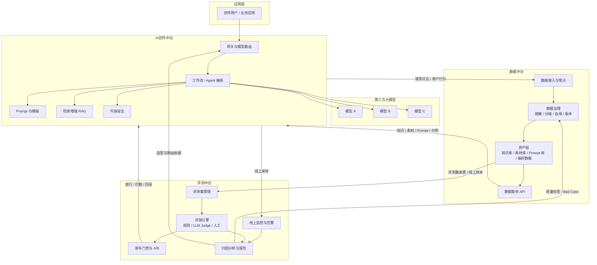
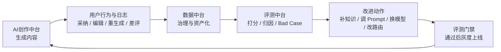
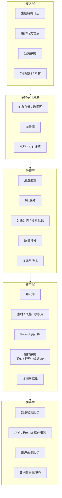
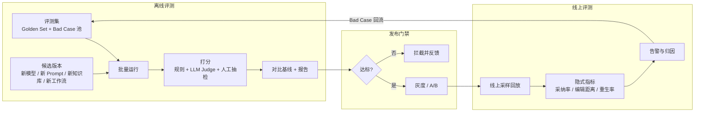
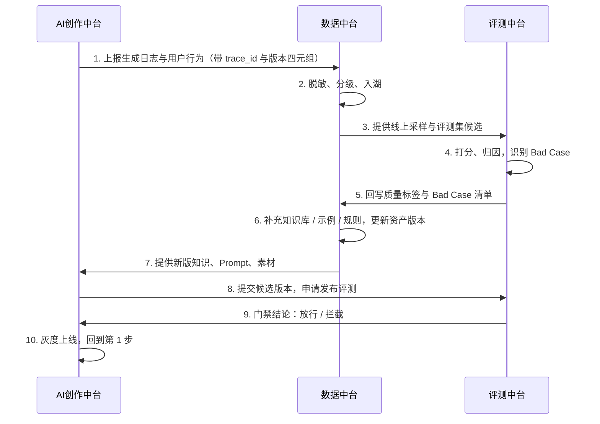
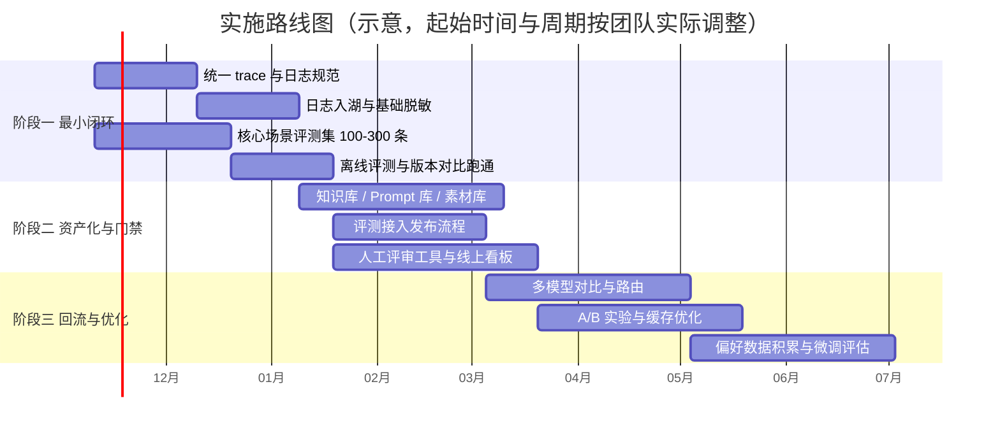

# 数据中台 & 评测中台规划方案

> 适用前提：已有智能平台并整合了 AI创作中台；当前以调用第三方大模型为主，暂无自训模型计划。
> 图表使用 Mermaid 语法，可在 GitHub / GitLab / Typora / VS Code（Markdown Preview Mermaid Support）/ Obsidian 等中直接渲染。

---

## 1. 背景与目标

### 1.1 背景

AI创作中台已经具备模型调用、Prompt/模板、工作流编排等能力。随着使用规模扩大，出现三类共性问题：

1. **看不清**：生成质量好不好、哪里不好，缺少统一、可量化的依据。
2. **改不稳**：换模型、改 Prompt、更新知识库全凭经验，上线后才发现退化。
3. **沉淀不下来**：用户的采纳、编辑、拒绝等宝贵反馈没有被系统化地回收和复用。

### 1.2 目标

| 中台 | 一句话定位 | 核心价值 |
|---|---|---|
| 数据中台 | AI 的"资产与上下文工厂" | 把日志、知识、素材、Prompt、用户反馈变成可治理、可复用、可回流的资产 |
| 评测中台 | AI 的"质量与发布守门人" | 定义"好"，验证每一次变更，驱动选型与路由决策 |

### 1.3 核心判断

> 在以第三方模型为主的前提下，**模型本身不是壁垒，"模型之外的一切"才是**：Prompt、知识库、工作流、路由策略、评测集、用户反馈数据。
> 数据中台负责积累这些资产，评测中台负责证明并保护这些资产的价值。

---

## 2. 设计原则

1. **闭环优先于完备**：先跑通"日志 → 评测 → 改进 → 上线 → 再日志"的最小闭环，再逐步加厚。
2. **评测先行（轻量）**：没有评测，就无法证明数据建设的价值。评测与日志同步起步。
3. **全链路版本可追溯**：每次生成都能还原 `模型版本 + Prompt 版本 + 知识库版本 + 参数 + 评测集版本`。
4. **合规前置**：数据入湖时就做脱敏、分级、授权标记，而不是事后补。
5. **模型无关**：评测与数据资产不绑定某一家供应商，降低锁定风险。
6. **质量、成本、延迟三角并重**：任何评测结论都同时呈现三项指标。
7. **场景驱动**：先在 1–2 个高频创作场景做样板，再抽象为平台能力。

---

## 3. 整体架构



---

## 4. 数据飞轮



**飞轮转速的关键**：Bad Case 能否被自动发现、快速归因、低成本回流为资产。

---

## 5. 数据中台设计

### 5.1 能力分层



### 5.2 能力清单与优先级

| 能力域 | 具体内容（创作场景） | 优先级 |
|---|---|---|
| 数据接入 | 生成链路日志（Prompt、参数、模型版本、检索片段、输出、耗时、成本）；用户行为（采纳、编辑 diff、重生成、导出、点赞/踩） | P0 |
| 数据治理 | 清洗去重、PII 脱敏、版权/授权标记、内容安全分级、血缘与版本 | P0 |
| 知识资产化 | 知识库切片、向量化、增量更新、版本管理 | P0 |
| Prompt 资产库 | Prompt 版本化，关联效果数据（采纳率、评测分） | P1 |
| 素材/风格/品牌库 | 模板库、风格库、品牌词库、禁用词库 | P1 |
| 偏好数据沉淀 | 采纳/拒绝对、用户编辑 diff 自动挖掘（先存储，暂不一定训练） | P1 |
| 数据集管理 | 评测集、回流集版本化；数据导出 | P1 |
| 标注能力 | 人审队列、标注工具（轻量即可） | P2 |
| 分析看板 | 使用分析、成本分析、内容效果分析 | P2 |
| 训练数据工厂 | SFT / DPO 数据集构建（仅在有微调计划后启动） | 后置 |

### 5.3 如何反哺 AI创作中台

| 反哺目标 | 数据中台提供什么 | 创作中台如何使用 |
|---|---|---|
| 事实性 / 减少幻觉 | 高质量、可更新的知识库 | RAG 检索增强 |
| 风格与品牌一致 | 风格库、品牌词库、禁用词库 | 注入 Prompt、后置校验 |
| 生成质量 | 高采纳率样本、优质 Prompt | 少样本示例自动挑选、模板推荐 |
| 个性化 | 用户风格画像、历史偏好 | 动态拼装个性化 Prompt（不依赖微调） |
| 成本 | 高频请求识别、相似请求聚类 | 语义缓存、简单任务路由小模型 |
| 安全 | 违规样本沉淀 | 前置/后置审核规则与小分类器 |
| 未来微调 | 偏好对、编辑 diff 积累 | 需要时可直接转为 SFT / DPO 数据 |

### 5.4 关键数据规范：生成日志（示例字段）

```json
{
  "trace_id": "全链路唯一 ID",
  "timestamp": "2026-11-03T10:00:00Z",
  "tenant_id": "租户/业务线",
  "user_id": "脱敏后的用户标识",
  "scene": "创作场景标识，如 marketing_copy",
  "versions": {
    "model": "供应商 + 模型 + 版本",
    "prompt": "prompt_template_id@version",
    "kb": "knowledge_base_id@version",
    "workflow": "workflow_id@version"
  },
  "params": { "temperature": 0.7, "max_tokens": 2000 },
  "input": "脱敏后的用户输入",
  "retrieved_chunks": ["chunk_id_1", "chunk_id_2"],
  "output": "模型输出",
  "metrics": { "latency_ms": 1800, "input_tokens": 900, "output_tokens": 600, "cost": 0.012 },
  "feedback": {
    "adopted": true,
    "regenerated_count": 1,
    "edit_distance_ratio": 0.18,
    "rating": null
  },
  "safety": { "flagged": false, "categories": [] }
}
```

> 字段仅为示例，需结合实际业务裁剪。核心原则：**`trace_id` 贯穿全链路，`versions` 四元组必填**。

---

## 6. 评测中台设计

### 6.1 评测流程



### 6.2 能力清单与优先级

| 能力域 | 具体内容 | 优先级 |
|---|---|---|
| 评测集管理 | Golden Set，按场景/难度/风险分层；版本化；防泄漏；Bad Case 池 | P0 |
| 评测引擎 | 规则指标（格式、长度、重复、敏感词）+ LLM-as-Judge（带 rubric） | P0 |
| 版本对比与回归 | 模型/Prompt/知识库/工作流变更的基线对比 | P0 |
| 发布门禁 | 接入发布流程，不达标不上线 | P1 |
| 人工评审 | 盲评、成对比较、抽检工具 | P1 |
| 线上监控 | 隐式指标看板、质量下滑告警、模型"静默变化"发现 | P1 |
| 多模型对比 | 同一评测集下对比质量/成本/延迟，支撑选型 | P1 |
| 归因分析 | 按场景、用户群切片；错误分类；拆解问题在模型/Prompt/检索/工作流哪一环 | P2 |
| A/B 实验 | 流量分桶、显著性检验 | P2 |
| Judge 校准 | 定期核对 Judge 与人工评分一致性；固定并记录 Judge 版本 | P1 |
| 多模态评测 | 图文一致性、美学评分、视频一致性（视业务引入） | 按需 |
| 安全/红队评测 | 越狱、违规内容、品牌风险测试集 | P2 |

### 6.3 创作场景的评测维度（Rubric 示例）

创作类内容主观性强，建议拆成多维 rubric，每维 1–5 分并附评分锚点：

| 维度 | 说明 |
|---|---|
| 相关性 | 是否紧扣用户意图与指令 |
| 事实性 | 事实、数据、引用是否准确（有知识库时核对检索片段） |
| 风格一致 | 是否符合指定风格 / 品牌调性 |
| 合规安全 | 是否包含违规、敏感、侵权风险内容 |
| 可用性 | 用户无需大改即可使用的程度 |
| 表达质量 | 流畅度、结构、创意性 |

**客观信号交叉验证**：采纳率、编辑距离占比、重生成率、导出率。LLM Judge 分数与这些信号长期不相关时，说明 rubric 或 Judge 需要重新校准。

### 6.4 发布门禁规则（示例，阈值需按业务标定）

| 检查项 | 示例规则 |
|---|---|
| 总体质量 | 综合得分不低于基线（允许小幅波动区间） |
| 核心场景 | 任一核心场景得分不得显著下降 |
| 安全合规 | 安全类评测零退化 |
| 成本 | 单次平均成本上涨不超过约定比例，或有对应质量收益 |
| 延迟 | P95 延迟不超过约定上限 |
| 人工抽检 | 抽检通过率达标 |

### 6.5 如何反哺 AI创作中台

| 反哺目标 | 评测中台提供什么 | 创作中台如何使用 |
|---|---|---|
| 变更安全 | 发布门禁结论 | 自动放行 / 拦截 / 回滚 |
| 模型选型与路由 | 各场景下模型的质量-成本-延迟对比 | 驱动路由表：哪类任务用哪个模型 |
| Prompt / 工作流迭代 | A/B 与离线对比数据 | 用数据决定保留哪个版本 |
| 供应商风险 | 版本漂移检测、跨模型回归 | 供应商升级/下线时快速判断换不换 |
| 持续改进 | Bad Case 与错误归因 | 回流数据中台，补知识、补示例、补规则 |
| 数据质量 | 质量评分 | 过滤低质样本，筛选高价值偏好数据 |

---

## 7. 两个中台如何联动



**联动的三个约定**

1. **统一版本体系**：`模型版本 + Prompt 版本 + 知识库版本 + 工作流版本 + 评测集版本`，所有日志、评测报告都带这组标识。
2. **统一 `trace_id`**：从用户请求到评测样本可一键回溯。
3. **统一质量定义**：评测 rubric 同时作为数据质量打分的依据，避免两套标准。

---

## 8. 与 AI创作中台的接口

| 接口 | 方向 | 内容 |
|---|---|---|
| 埋点 SDK / 日志规范 | 创作中台 → 数据中台 | 生成日志、用户行为 |
| 知识 / 素材 / 示例服务 | 数据中台 → 创作中台 | 检索、推荐、画像 |
| 评测样本采样 | 数据中台 → 评测中台 | 线上样本、评测集候选 |
| 评测任务提交 | 创作中台 → 评测中台 | 候选版本、评测范围 |
| 门禁结论 | 评测中台 → 创作中台 | 放行 / 拦截 / 回滚建议 |
| 路由策略输入 | 评测中台 → 创作中台 | 场景-模型质量成本表 |
| 质量标签与 Bad Case | 评测中台 → 数据中台 | 回流与治理依据 |

---

## 9. 实施路线图



### 各阶段交付物与验收

| 阶段 | 交付物 | 验收标准 |
|---|---|---|
| 一：最小闭环 | 日志规范与入湖；1–2 个场景评测集；离线评测与对比报告 | 任一 Prompt / 模型变更，能在一天内拿到对比报告 |
| 二：资产化与门禁 | 知识库 / Prompt 库 / 素材库；评测接入发布；人工评审工具；线上看板 | 核心场景变更 100% 经过评测门禁；线上质量可视 |
| 三：回流与优化 | 多模型路由；A/B 平台；语义缓存；偏好数据集 | 路由带来可量化的成本下降且质量不降；Bad Case 回流周期可控 |

---

## 10. 指标体系

| 类别 | 指标 | 说明 |
|---|---|---|
| 质量 | rubric 综合得分、各维度得分 | 离线评测 |
| 用户信号 | 采纳率、编辑距离占比、重生成率、导出率、留存 | 线上，最贴近真实价值 |
| 成本 | 单次请求成本、单次采纳成本 | 单次采纳成本比单次请求成本更能反映价值 |
| 延迟 | P50 / P95 延迟 | |
| 稳定性 | 版本漂移告警次数、回归失败率 | 第三方模型静默变化的探测 |
| 数据资产 | 知识库覆盖率、新鲜度、Prompt 复用率、Bad Case 闭环率 | 数据中台自身健康度 |
| 评测体系 | Judge 与人工一致性、评测集覆盖度与更新频率 | 评测中台自身可信度 |

---

## 11. 风险与对策

| 风险 | 对策 |
|---|---|
| 一上来做大而全，长期无产出 | 先用 1–2 个高频场景做样板，阶段一以闭环为目标 |
| LLM Judge 不准 | 带锚点的 rubric、人工抽检校准、多 Judge 交叉、固定 Judge 版本 |
| 评测集污染（进入训练或 Prompt 示例） | 评测集与示例集物理隔离，访问控制，定期更新 |
| 第三方模型静默升级导致质量漂移 | 线上采样监控 + 固定评测集定时回跑 |
| 供应商锁定 | 评测集与 Prompt 模型无关化，保持多模型回归能力 |
| 用户数据发往外部模型的合规风险 | 入模前脱敏分级；核查供应商数据留存与训练条款；授权标记 |
| 指标与业务脱节 | 评测指标与采纳率、留存等业务结果定期做相关性分析 |
| 评测集与真实使用逐渐脱节 | 定期从线上样本和 Bad Case 补充更新 |
| 版本不可追溯导致无法归因 | 版本四元组必填，日志校验不通过则告警 |

---

## 12. 待确认事项

建议在启动前与业务、技术、合规三方对齐：

1. 首批样板场景选哪 1–2 个？（依据：调用量、业务价值、质量痛点）
2. 创作模态范围：纯文本，还是含图像 / 视频？这决定评测方法与存储方案。
3. 用户数据的使用边界：哪些数据允许发送给外部模型、哪些允许用于后续优化？
4. 团队与资源：数据工程、评测/算法、标注或评审人力的配置。
5. 是否有未来自训或微调计划？若有，数据中台的偏好数据与训练集能力需提前预留。
6. 现有基础设施：日志、数据湖、向量库、实验平台中哪些可复用？

---

*本文档为规划方案初稿，阈值、周期、字段等均为示例，需结合实际业务标定后落地。*
